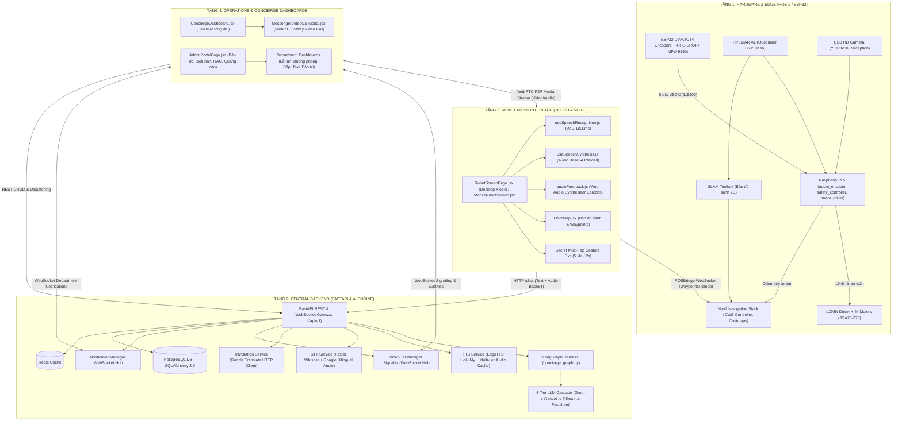
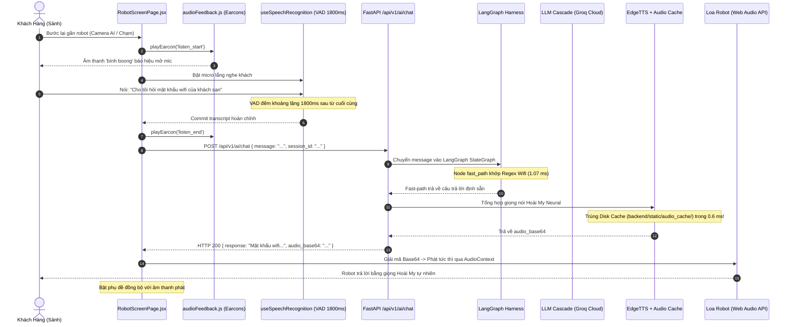
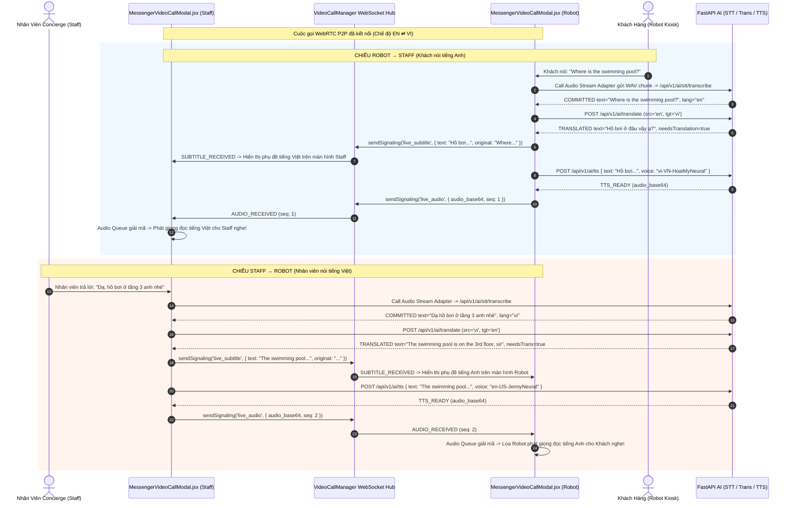
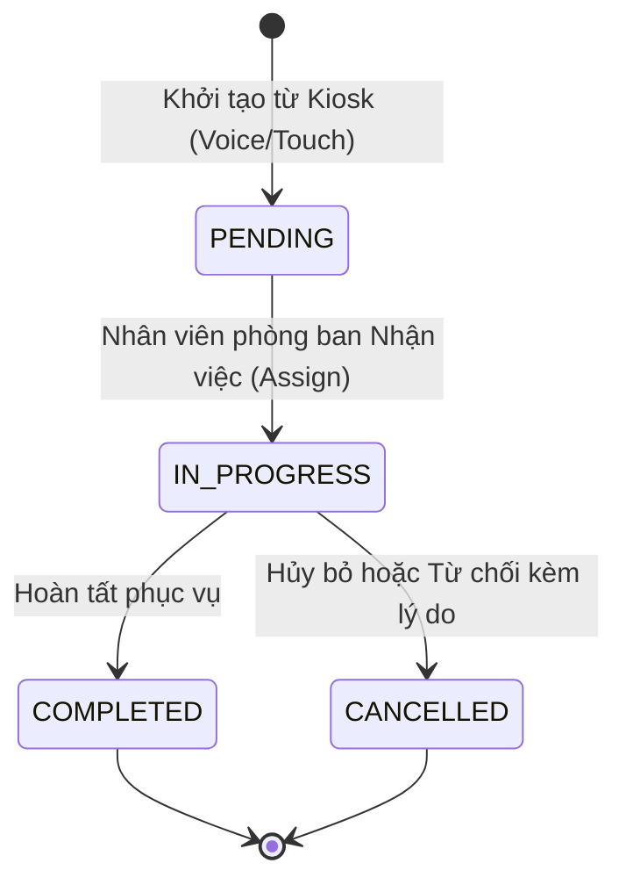

# TỔNG QUAN KIẾN TRÚC HỆ THỐNG HC-ROBOT (ARCHITECTURE)

> **Mục đích:** Đặc tả kiến trúc tổng thể, mô hình phân tầng, các luồng dữ liệu thời gian thực và cơ chế chịu lỗi của hệ thống Robot Trợ lý Dịch vụ Khách sạn (HC-Robot).
> **Ngày cập nhật đối chiếu:** 06/11/2026.
> **Tài liệu tham chiếu liên quan:**
> - Bản đồ file: [[01-File-Map|Bản đồ source code (File Map)]]
> - Báo cáo tối ưu hội thoại: [[ROBOT_CONVERSATION_FLOW_REPORT|Báo cáo Hội thoại Voice Pipeline]]
> - Đặc tả LangGraph: [[guides/langgraph_harness|LangGraph Agent Harness]]
> - Đặc tả phần cứng & ROS 2: [[guides/hardware_architecture|Đặc Tả Phần Cứng & ROS 2 Edge]]
> - Luồng Video Call 2 chiều: [[guides/video_call_flow|Luồng Phiên dịch Video Call (Staff ⇄ Robot)]] (Chi tiết mã nguồn: [video-call-flow.md](../frontend/src/docs/video-call-flow.md))
> - Quy chuẩn 7 Stepflows: [[workflows/stepflow|Kịch bản Stepflow Robot]]

---

## 1. Sơ Đồ Kiến Trúc Phân Tầng Tổng Thể

Hệ thống HC-Robot được thiết kế theo mô hình 4 tầng phân tán, kết nối qua mạng cục bộ LAN / VPN Tailscale:

---

## 2. Luồng Xử Lý Hội Thoại Giọng Nói Tại Robot Kiosk (Voice Interaction Flow)

Luồng tương tác chính giữa khách hàng và Robot tại tiền sảnh được tối ưu hóa theo mô hình phản hồi tức thì:

### Điểm kỹ thuật cốt lõi:
1. **VAD Silence Duration (1800 ms):** Được cấu hình tại `SPEECH_FINAL_SILENCE_MS = 1800` trong `frontend/src/hooks/useSpeechRecognition.js` và `silenceTimeoutMs: 1800` trong `RobotScreenPage.jsx`. Con số này đã được kiểm nghiệm thực tế giúp triệt tiêu hoàn toàn hiện tượng cướp lời khi khách ngắt quãng suy nghĩ, đồng thời vẫn giữ được nhịp phản hồi tự nhiên.
2. **Single-Shot Payload:** `/api/v1/ai/chat` trả về đồng thời cả `response` (văn bản) và `audio_base64` (âm thanh). Frontend không cần gọi thêm request thứ hai lên `/tts`, tiết kiệm 250 - 400ms độ trễ mạng.
3. **Earcon Không Phụ Thuộc File Ngoại Vi:** `audioFeedback.js` sử dụng Web Audio API thuần (`OscillatorNode` và `GainNode`) để tự tổng hợp sóng âm âm học tần số chính xác (ví dụ `listen_start`: 587Hz $\rightarrow$ 880Hz), không bao giờ gặp lỗi 404 hoặc lag do tải file MP3.

---

## 3. Kiến Trúc Phiên Dịch Video Call Hai Chiều (Staff ⇄ Robot)

Khi khách cần hỗ trợ chuyên sâu, Robot Kiosk kết nối cuộc gọi video call WebRTC với Bàn trực Concierge:

### Cơ chế chống treo và phục hồi hàng đợi âm thanh:
1. **Call Audio Stream STT Adapter:** Đọc 16kHz PCM WAV trực tiếp từ `localStreamRef` bằng Web Audio ScriptProcessor/AudioWorklet và gửi về backend. Cơ chế này hoạt động độc lập hoàn toàn với `webkitSpeechRecognition`, khắc phục triệt để lỗi trình duyệt tự hủy STT khi chạy 2 tab hoặc WebRTC microphone lock.
2. **Playback Watchdog (`playbackWatchdogRef`):** Đặt timeout 400ms khi gọi `AudioContext.resume()`. Nếu sau thời gian quy định không nhận được callback `onended`, watchdog sẽ tự động giải phóng cờ `isAiSpeakingRef`, chống kẹt hàng đợi phát âm thanh.
3. **Bỏ qua tuần tự lỗi (`advanceExpectedSeqOnFailure`):** Khi một gói âm thanh TTS bị lỗi (`live_audio_status: { status: 'failed', seq }`), phía nhận lập tức đẩy con trỏ `expectedPlaySeqRef` tiến lên 1 bước, không bắt các câu nói kế tiếp phải chờ 1.2s timeout.

---

## 4. Mô Hình Điều Phối Nghiệp Vụ Khách Sạn (Operations & Stepflows)

Mọi yêu cầu dịch vụ phát sinh từ hội thoại AI hoặc thao tác bấm chọn trên Kiosk Robot được chuyển hóa thành các phiếu nghiệp vụ (Department Tickets) theo vòng đời thống nhất:

### Các phòng ban nghiệp vụ tích hợp:
- **Lễ tân (Reception):** Nhận diện thủ tục nhận/trả phòng, giải đáp quy định lưu trú.
- **Buồng phòng (Housekeeping):** Dọn phòng, bổ sung khăn tắm, nước uống, đồ amenities.
- **Bếp & Nhà hàng (Kitchen & F&B):** Tiếp nhận order món từ `RobotFoodMenuScreen.jsx`, chuyển thẳng vào KDS Bếp (`KitchenDashboard.jsx`).
- **Phục vụ phòng (Room Service):** Xác thực số phòng và mã PIN khách hàng qua `RoomPickerModal.jsx` (đã bỏ cơ chế quẹt thẻ NFC cũ), chuyển yêu cầu giao đồ ăn/dụng cụ lên phòng.
- **Vận chuyển & Đặt xe (Taxi Services):** Hỗ trợ khách đặt taxi 4 chỗ/7 chỗ, ước tính thời gian đón và hãng xe đối tác.
- **Hành lý (Bell Services):** Hỗ trợ mang vác hành lý lên phòng hoặc gửi đồ tại sảnh.
- **Kỹ thuật & Bảo trì (Maintenance):** Báo hỏng điều hòa, bóng đèn, khóa cửa phòng.

### 8 Khối lệnh Stepflow cốt lõi (Workflow Builder):
1. **MOVE:** Điều khiển Robot tự hành tới điểm đích (Waypoints: Lobby, Reception, Restroom, Sofa,...) bằng ROS 2 Nav2.
2. **GREET:** Chào mừng khách kèm biểu cảm cười trên `RobotFace.jsx` và nhấp nháy đèn trạng thái.
3. **SPEAK:** Phát câu thông báo hoặc giải đáp ra loa bằng EdgeTTS Hoài My.
4. **SHOW:** Hiển thị giao diện menu món ăn, bản đồ tiện ích hoặc slide quảng cáo khuyến mãi.
5. **LISTEN:** Mở micro thu âm câu trả lời của khách (kèm VAD 1800ms).
6. **RECOMMEND:** Đề xuất thông minh món ăn hoặc dịch vụ phù hợp với khung giờ.
7. **CREATE_REQUEST:** Tự động đóng gói phiếu dịch vụ gửi về phòng ban tương ứng qua WebSocket.
8. **FEEDBACK:** Bật modal 5 sao thu thập mức độ hài lòng của khách trong 3 giây.

---

## 5. Cơ Chế Chịu Lỗi & Chiến Lược Dự Phòng (Resilience & Fallback Strategy)

Hệ thống HC-Robot được trang bị các lớp phòng vệ (Graceful Degradation) đảm bảo robot không bao giờ rơi vào trạng thái "chết lặng" khi gặp sự cố mạng hoặc phần cứng:

| Thành phần | Mức ưu tiên 1 (Chính) | Mức ưu tiên 2 (Dự phòng 1) | Mức ưu tiên 3 (Dự phòng 2) | Mức ưu tiên 4 (Cứu cánh cuối cùng) |
| :--- | :--- | :--- | :--- | :--- |
| **LLM Inference** | **Groq Cloud** (`llama-3.3-70b-versatile` / `llama-3.1-8b-instant`) | **Google Gemini Flash** (`gemini-1.5-flash`) | **Ollama Local** (`qwen2.5:3b` trên NUC) | **Factsheet tĩnh** (Đọc từ điển câu trả lời cứng trong file MD) |
| **Text-to-Speech (TTS)** | **EdgeTTS Hoài My** (`vi-VN-HoaiMyNeural` tải từ đám mây) | **Multi-tier Audio Cache** (File MP3 có sẵn trên ổ cứng máy chủ) | **Google Translate TTS HTTP** | **Web Speech API** (Bộ đọc giọng nói tích hợp sẵn trong trình duyệt) |
| **Speech-to-Text (STT)** | **Web Speech API** (`webkitSpeechRecognition`) | **Call Audio Stream STT Adapter** (16kHz PCM WAV qua `/stt/transcribe`) | **Google Bilingual STT** (Chấm điểm độ tự tin âm học song song EN/VI) | **Màn hình cảm ứng** (Khách bấm nút chọn trực tiếp) |
| **Định vị & Bản đồ** | **LiDAR SLAM 2D + Nav2** (Tự hành thông minh) | **Waypoint tĩnh** (Di chuyển theo các điểm mốc đã lưu sẵn) | **Teleop Web Control** (Nhân viên lái thủ công từ xa qua phím mũi tên) | **Đứng yên tại trạm chào** |
