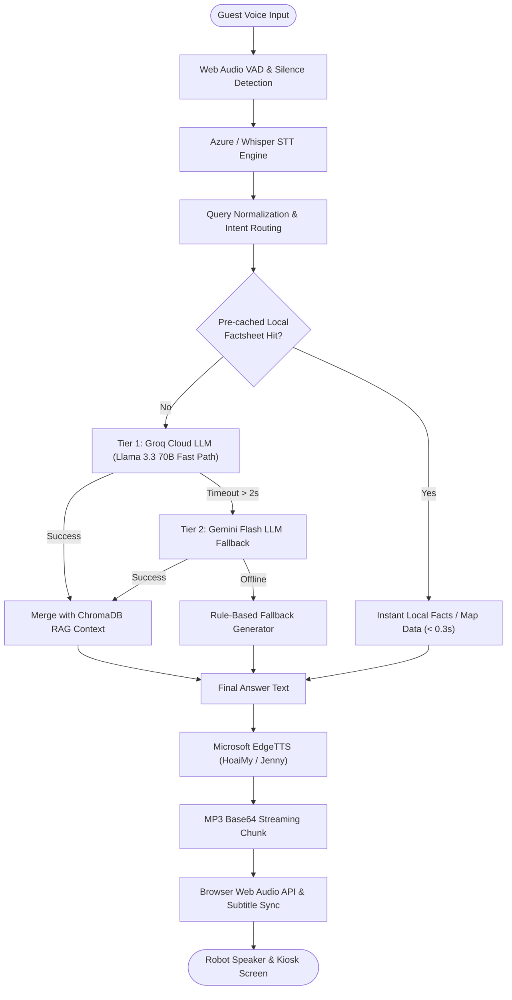
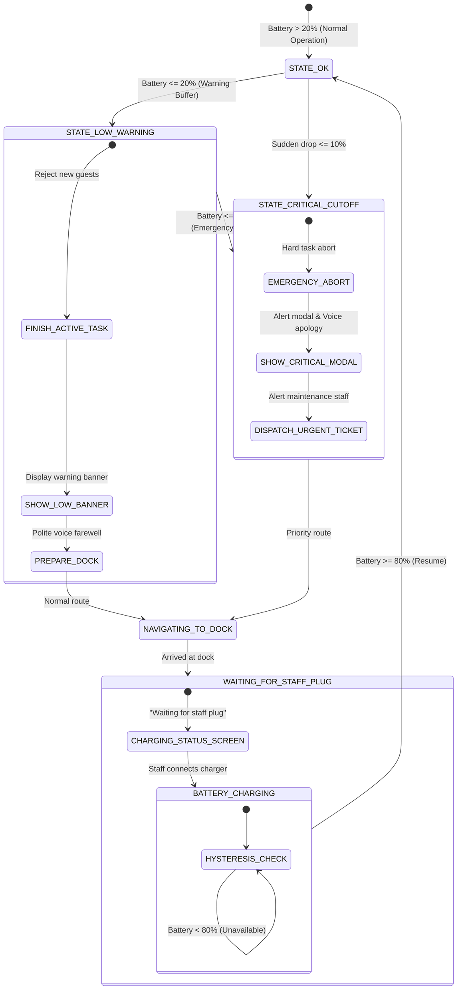
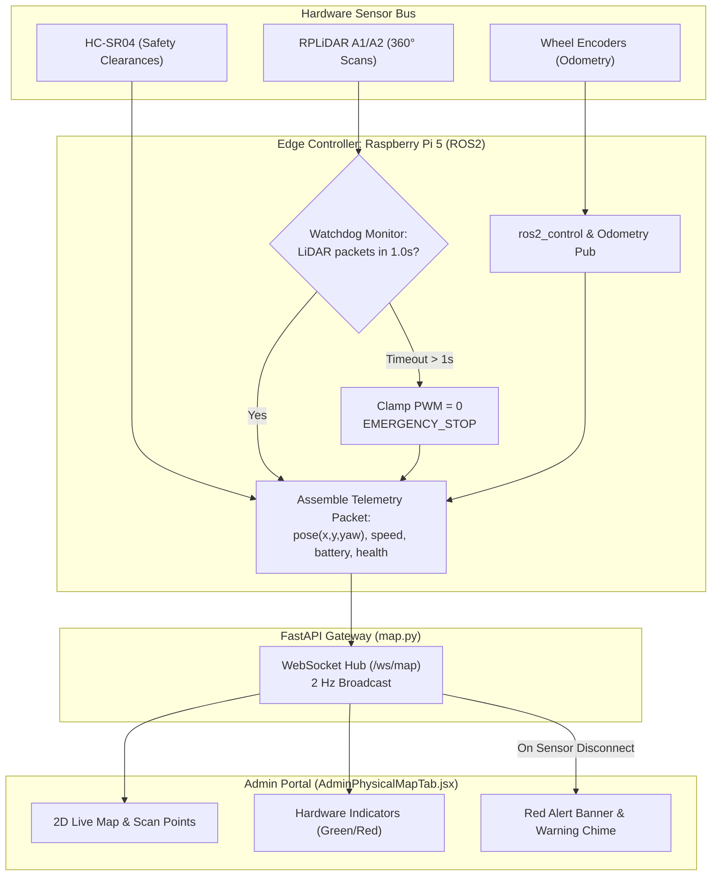
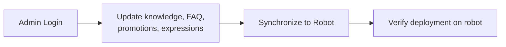
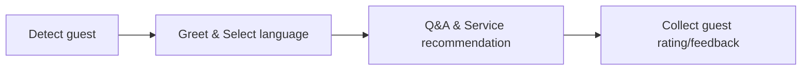
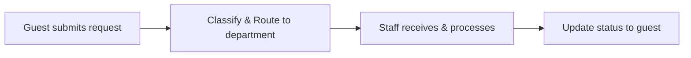
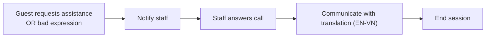
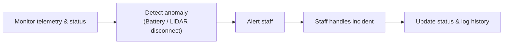
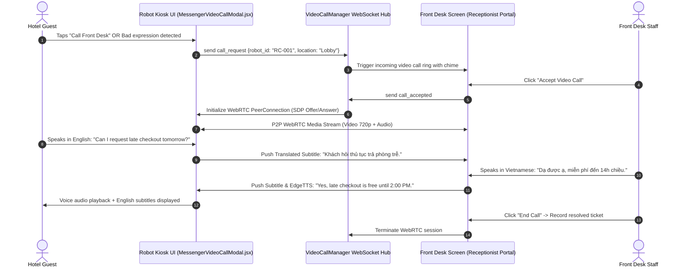

**SEP490 · CAPSTONE PROJECT · REVIEW 2 · BM01**

# **Design Brief – Review 2**

*Form BM01. Sections 0–8: maximum 4 A4 pages (font 11, margins 2 cm). Appendix A is not counted. Remove all grey guidance text and example rows, then export to PDF. File name: SWP490_FA26SE905_R2_DesignBrief.pdf*

## **0. Header**

| Project code | FA26SE905 |
| :---- | :---- |
| **Project name** | Intelligent Hotel Concierge Robot (HC-Robot) |
| **Team** |  |
| **Supervisor** |  |
| **Repository link (tag review-2)** | https://github.com/hoangcv-work/HC-Robot/tree/review-2 |
| **Version** | 2.0 |
| **Date** | November 9, 2026 |

## **1. Scope**

### **1.1 Registration Changes**

| Section | Current | Proposed | Reason |
| :---- | :---- | :---- | :---- |
| Core Workflows | Fragmented single-action flows (MOVE, GREET, FEEDBACK) centered solely on robot. | 5 standardized workflows: Admin Configuration, Guest Info & Recommendation, Service Request Handling, Robot-to-Human Handoff, and Robot Monitoring & Incident Handling. | Replace micro-actions with comprehensive multi-actor SOPs covering guest service, administration, and incident recovery. |
| Robot Monitoring & Telemetry | Basic status indicator without centralized telemetry. | Real-time monitoring tracking Cartesian pose (x, y, yaw), velocity, LiDAR scans, and hardware health (COM/ultrasonic/Pi 5). | Fulfill supervisor requirement for live fleet localization and device health tracking. |
| Battery Buffer Strategy | Single low-battery trigger without operational buffers. | Dual-buffer policy: 20% Warning Buffer (drain current task, show banner, block new sessions), 10% Critical Cut-off (abort task, alert modal, auto-dock, alert maintenance), and 80% resume hysteresis. | Fulfill supervisor requirement for explicit buffer thresholds for guest notices, UI warnings, and auto-docking. |

### **1.2 Out of Scope**

| Item | Reason |
| :---- | :---- |
| Restaurant Dine-In & Table POS | System handles Hotel Kitchen room-service ticket dispatch (`kitchen.py`); on-premise table seating and dine-in POS are excluded. |
| Multi-Floor Elevator Integration | Hardware navigation is restricted to single-floor lobby, lounge, and reception areas for Review 2 defense. |
| Physical Luggage Transportation | Robot scope is information and escort concierge; heavy luggage is handled by bell staff. |
| Autonomous Outdoor Navigation | LiDAR and ultrasonic safety ranges are calibrated exclusively for indoor hotel flooring. |

## **2. System at a Glance**

HC-Robot is an autonomous concierge resolving lobby congestion and service delays. Serving Guests, Front Desk, Department Leads, Kitchen, Maintenance, and Admins, it provides <2s bilingual voice AI (Groq/Gemini LLM with local ChromaDB RAG and EdgeTTS), autonomous lobby escorting via 2D LiDAR SLAM, and hotel service ticketing with head lead confirmation. A 2 Hz WebSocket dashboard monitors fleet pose, sensor health, and battery buffer safety. (Architecture ref: `docs/02-Architecture.md`).

## **3. Key Design Decisions**

| ID | Decision | Options considered | Chosen option and rationale | Owner | Related FR / diagram |
| :---- | :---- | :---- | :---- | :---- | :---- |
| *D1* | Multi-Tier Hybrid AI Voice Pipeline | (A) Local Ollama; (B) Cloud LLM; (C) Tier 1 Groq / Tier 2 Gemini + Local RAG factsheets + EdgeTTS. | Option C. Reduces conversational latency from 15s to <2s on edge hardware with offline factsheet fallback. |  | FR-AI-01 / Architecture Fig 2.1 |
| *D2* | Dual-Threshold Battery Buffer & Docking | (A) Single 15% threshold; (B) Dual buffer (20% warning drain, 10% critical cut-off, 80% recharge hysteresis). | Option B. Prevents mid-lobby stalls while avoiding abrupt session termination at safe battery levels. |  | FR-PWR-02 / Battery State Machine |
| *D3* | 2 Hz Telemetry & Hardware Health Stream | (A) 5s REST polling; (B) 2-5 Hz WebSocket broadcasting pose, LiDAR scans, velocities, and hardware bus health. | Option B. Enables zero-latency map tracking and immediate detection of sensor/COM disconnects. |  | FR-MON-01 / Telemetry Flowchart |
| *D4* | Standardized Core Workflows (WF-01..05) | (A) 10 micro-actions; (B) 5 standardized operational workflows (Admin Config, Guest Info, Request Handling, Handoff, Monitoring). | Option B. Establishes realistic operational procedures directly aligned with presentation slides and defense targets. |  | FR-WF-01..05 / Core Workflows |
| *D5* | Robot-to-Human Handoff with Translation | (A) Text ticket; (B) 2-way WebRTC screen call with live speech translation (EN, VN) triggered by request or bad expression. | Option B. Enables instant front-desk takeover when guest requests staff or displays frustration. |  | FR-CALL-01 / Handoff Architecture |

## **4. Top Risks**

| ID | Risk | Impact | How we verify or mitigate | Owner |
| :---- | :---- | :---- | :---- | :---- |
| *R1* | Battery exhaustion during guest escort. | Robot stalls mid-corridor, blocking lobby passage. | 20% warning blocks new tasks; 10% critical cut-off aborts task, plays voice apology, auto-docks, and alerts maintenance. |  |
| *R2* | Sensor disconnect (LiDAR COM port / ultrasonic). | Blind navigation, collision hazard, lost pose. | Watchdog halts motors (PWM=0, EMERGENCY_STOP) if packets drop >1.0s; triggers red alert on Admin Portal. |  |
| *R3* | High LLM latency or cloud API outage. | Dialogue stalls with dead silence. | Earcon turn chime, visual thinking indicator, barge-in voice interruption, and auto-fallback to local cached factsheets. |  |

## **5. Known Gaps**

| ID | Gap | Location | Plan | Owner | Due |
| :---- | :---- | :---- | :---- | :---- | :---- |
| *G-01* | Battery buffer logic in frontend was unaligned with backend robot model. | `frontend/.../batteryPolicy.js` vs `backend/app/models/robot.py` | Align `Robot.status` flags with 20% LOW and 10% CRITICAL thresholds; verify via integration test. |  | 2026-11-12 |
| *G-02* | Fleet telemetry stream lacked structured hardware health metrics. | `backend/app/api/v1/endpoints/map.py` | Add structured `device_health` (LiDAR COM, ultrasonic clearances) to WebSocket stream. |  | 2026-11-13 |
| *G-03* | Kiosk UI lacked persistent warning banner in 10-20% buffer zone. | `frontend/src/pages/guest/RobotScreenPage.jsx` | Implement top warning notification bar informing guests of upcoming recharge return. |  | 2026-11-14 |

## **6. Proposed Mandatory Features**

| ID | Feature | Actor | Acceptance criteria (testable) | Test | Status |
| :---- | :---- | :---- | :---- | :---- | :---- |
| *F-01* | Admin Knowledge & Configuration | Hotel Admin | Admin logs in, updates knowledge files, FAQs, promotions, and expressions, syncs to robot, and verifies deployment in $< 3.0$s. | TC-F01-01..03 | Done |
| *F-02* | Guest Info & Recommendation | Hotel Guest | Detects guest approach, prompts language, answers queries via AI voice in $< 2.0$s, provides recommendations, and collects rating. | TC-F02-01..03 | Done |
| *F-03* | Service Request Handling & Routing | Hotel Guest / Head Lead / Staff | Classifies service requests from kiosk, routes ticket to target department, and updates fulfillment status to guest in real time. | TC-F03-01..03 | Done |
| *F-04* | Robot-to-Human Handoff & Translation | Hotel Guest / Front Desk Staff | Triggers on guest request or bad expression detection; connects 2-way screen call with live EN-VN translation. | TC-F04-01..03 | Done |
| *F-05* | Robot Monitoring & Incident Handling | Operations Staff / Admin | Tracks live pose, velocity, battery %, and LiDAR scans at $\ge 2$ Hz; engages emergency stop and alerts staff upon anomaly. | TC-F05-01..03 | Done |
| *F-06* | Multi-Tier Battery Buffer & Auto-Docking | Concierge Robot / Maintenance Staff | Blocks new sessions and displays banner at $\le 20\%$; aborts session, shows modal, docks, and creates ticket at $\le 10\%$; resumes at $\ge 80\%$. | TC-F06-01..04 | In progress |

## **7. Non-Functional Requirements**

| ID | Quality attribute | Metric | Threshold | Measurement method |
| :---- | :---- | :---- | :---- | :---- |
| *NFR-01* | Performance (Voice Latency) | End-to-end voice query response (STT + LLM RAG + TTS) | $\le 2.0$ seconds | Timestamp delta between speech end and audio playback start across 50 sample queries. |
| *NFR-02* | Safety (Battery Buffer) | Autonomous docking before complete power loss | 0 mid-lobby stalls; auto-dock triggers at $\ge 10\%$ | Automated discharge stress test repeating escort runs until 20% and 10% triggers. |
| *NFR-03* | Telemetry Freshness | WebSocket update frequency and latency to Admin | $\ge 2$ Hz; latency $\le 500$ ms | Client-side packet arrival timestamp delta during active navigation. |
| *NFR-04* | Navigation Safety | Collision avoidance emergency stop distance | Stop distance $\le 0.3$ meters at 0.35 m/s | Physical sudden-obstacle insertion in trajectory; ultrasonic and LiDAR reaction test. |
| *NFR-05* | System Reliability | Service uptime during lobby operating hours (07:00 - 22:00) | $\ge 99.0\%$ uptime | Server heartbeat logs and error rate tracking over 7 consecutive operational days. |
| *NFR-06* | Knowledge Sync Latency | Admin configuration to robot active knowledge sync | $\le 3.0$ seconds | Timestamp delta between admin save and robot RAG vector index reload. |

## **8. Ownership Map**

| Member | Role | Owned parts (2–3) | Main workflow owned | Key decisions / PRs |
| :---- | :---- | :---- | :---- | :---- |
|  | Fullstack & QA Engineer | Admin Portal, Expression / Promotion / FAQ Config, Knowledge Base Management | WF-01: Admin Configuration | D4 (Standardized Workflows), PR #31 (Admin Config & CI Test Suite) |
|  | AI & NLP Engineer | Human Approach Detection, Voice Recommendation, Hotel Info / Instructions | WF-02: Guest Information & Recommendation | D1 (Hybrid AI Voice Pipeline), PR #22 (Groq/Gemini Multi-Tier Engine) |
|  | Fullstack Developer | Department Ticket Routing, Room Service Dispatch, Head Lead Approval Flow | WF-03: Guest Service Request Handling | D4 (Service Dispatch), PR #15 (Ticketing & Notification System) |
|  | Frontend & WebRTC Engineer | Kiosk Touchscreen, 2-Way Screen Video Call, Live Speech Translation (EN, VN) | WF-04: Robot-to-Human Handoff | D5 (Handoff & Video Translation), PR #27 (Video Call & Audio Stream) |
|  | Robotics & Embedded Lead | ROS2 Navigation, Fleet Telemetry, LiDAR Watchdog & Battery Buffer Docking | WF-05: Robot Monitoring & Incident Handling | D2 (Battery Policy), D3 (Telemetry WebSocket), PR #18 (Fleet Monitor) |

# **Appendix A – Defense 1.1 Targets**

### **A1. Main Workflows**

| ID | Workflow | Actors | Trigger | Business outcome | Features | Entity states | Owner |
| :---- | :---- | :---- | :---- | :---- | :---- | :---- | :---- |
| *WF-01* | Admin Configuration | Hotel Admin, Backend, Robot | Admin Login on management portal | Login $\rightarrow$ Update knowledge base, FAQ, promotions, expressions $\rightarrow$ Synchronize $\rightarrow$ Verify deployment on robot. | F-01 | `AdminSession`: AUTHENTICATED; `KnowledgeBase.status`: DRAFT $\rightarrow$ PUBLISHED; `Robot`: SYNCED |  |
| *WF-02* | Guest Information & Recommendation | Hotel Guest, Concierge Robot | Human approach detection (camera / touchscreen tap) | Detect guest $\rightarrow$ Greet & select language $\rightarrow$ Q&A, service recommendations $\rightarrow$ Collect guest rating/feedback. | F-02 | `Robot.status`: IDLE $\rightarrow$ INTERACTING $\rightarrow$ IDLE; `Feedback.rating`: recorded |  |
| *WF-03* | Guest Service Request Handling | Hotel Guest, Robot, Department Staff, Head Lead | Guest submits service request (Room Service, Taxi, Housekeeping) | Guest submits request $\rightarrow$ Classify & route to target department $\rightarrow$ Staff receives & fulfills $\rightarrow$ Update status to guest. | F-03 | `SupportRequest.status`: NEW $\rightarrow$ ASSIGNED $\rightarrow$ IN_PROGRESS $\rightarrow$ COMPLETED |  |
| *WF-04* | Robot-to-Human Handoff | Hotel Guest, Concierge Robot, Front Desk Staff | Guest requests staff OR robot detects bad expression | Guest requests assistance $\rightarrow$ Notify staff $\rightarrow$ Staff answers call $\rightarrow$ Communicate through robot screen with translation $\rightarrow$ End session. | F-04 | `ChatSession.status`: AI_ACTIVE $\rightarrow$ ESCALATED_HUMAN; `SupportRequest.status`: PENDING $\rightarrow$ RESOLVED |  |
| *WF-05* | Robot Monitoring & Incident Handling | Operations Staff, Maintenance, Robot, Backend | Periodic 2 Hz telemetry stream OR detected anomaly (LiDAR drop / low battery) | Monitor status $\rightarrow$ Detect anomaly (battery $\le 10\%$, LiDAR drop) $\rightarrow$ Alert staff $\rightarrow$ Staff handles incident $\rightarrow$ Update status and log history. | F-05, F-06 | `Robot.status`: IDLE / NAVIGATING $\rightarrow$ EMERGENCY_STOP / CHARGING; `IncidentLog.status`: LOGGED $\rightarrow$ RESOLVED |  |

### **A2. Demo Scenarios**

| ID | Workflow | Type | Preconditions and data | Main steps | Expected result | Presenter |
| :---- | :---- | :---- | :---- | :---- | :---- | :---- |
| *DS-01* | WF-01 | Main | Admin logs into portal; new promotion and FAQ items prepared. | 1. Admin logs into management portal. 2. Updates FAQ entries, promotions, and robot expressions. 3. Clicks "Synchronize to Robot". 4. Verifies updated content on robot kiosk screen. | New FAQs and promotions immediately synced and rendered on robot without system downtime. |  |
| *DS-02* | WF-01 | Exception | Admin uploads unsupported or corrupted document file. | 1. Admin uploads invalid document file. 2. System validates and rejects document. 3. Validation error displayed; sync aborted. 4. Robot maintains existing valid knowledge base. | Rejection alert shown; robot continues running on previous stable knowledge base. |  |
| *DS-03* | WF-02 | Main | Robot idle in lobby; guest approaches kiosk. | 1. Human approach detection triggers. 2. Robot greets guest and prompts language selection. 3. Guest asks questions and receives amenity recommendations. 4. Guest submits 5-star rating on screen. | Smooth conversational flow, personalized recommendations displayed, rating persisted. |  |
| *DS-04* | WF-02 | Exception | Guest walks away mid-conversation without rating (15s inactivity). | 1. Interaction active on screen. 2. Guest walks away without completing survey. 3. Inactivity timer reaches 15s without touch/voice. 4. Session auto-closes and resets to idle screensaver. | Session auto-recovers cleanly without getting stuck on active conversation. |  |
| *DS-05* | WF-03 | Main | Guest submits room service request (Room 402) on kiosk. | 1. Guest selects service request on kiosk. 2. System classifies request and routes to target department. 3. Department staff receives and accepts request. 4. Head Lead confirms and updates status to completed. | Ticket lifecycle completes (NEW $\rightarrow$ ASSIGNED $\rightarrow$ COMPLETED); guest notified on screen. |  |
| *DS-06* | WF-03 | Exception | Guest requests service during department off-hours. | 1. Guest submits off-hours service request. 2. System detects target department unavailable. 3. Robot prompts scheduled morning booking. 4. Ticket queued with scheduled status. | Clear instructions given to guest; ticket properly scheduled without being lost. |  |
| *DS-07* | WF-04 | Main | Guest during normal communication asks to speak with staff. | 1. Guest speaks: "I want to talk to front desk". 2. Robot alerts staff & displays waiting screen. 3. Staff picks up call; screen communication connects. 4. Live speech translation active (English, VN). | Successful 2-way screen communication with synchronized bilingual subtitles. |  |
| *DS-08* | WF-04 | Exception | Guest displays frustration during interaction. | 1. Normal communication in progress. 2. Robot detects guest's bad expression. 3. Robot automatically alerts staff. 4. Staff picks up call to assist guest directly. | Automated escalation without requiring guest to manually find or tap help buttons. |  |
| *DS-09* | WF-05 | Main | Operations staff monitors fleet on Admin Portal. | 1. Open Admin Physical Map tab. 2. Observe live pose and 360° LiDAR scan overlay. 3. Verify hardware indicators (Battery, LiDAR, Ultrasonic, Speed). | Robot marker moves synchronously at $\ge 2$ Hz; all hardware status pills display nominal green. |  |
| *DS-10* | WF-05 | Exception | Sensor disconnect (LiDAR COM port) or critical battery ($\le 10\%$). | 1. Sensor packet drop $> 1.0$s or battery hits 10%. 2. Watchdog triggers EMERGENCY_STOP / auto-dock. 3. Red alert banner and audio chime fire on portal. 4. Staff receives alert, resolves incident, updates log. | Emergency halt/docking executes safely; incident logged in audit history. |  |

### **A3. Functional Test Case Target**

| Source | Count | Minimum per item | Subtotal |
| :---- | :---- | :---- | :---- |
| *Mandatory features* | 6 | 3 | 18 |
| *Main workflows (end-to-end)* | 5 | 2 | 10 |
| *State transitions of main entities* | 5 | 2 | 10 |
| *Agreed NFRs* | 6 | 2 | 12 |
| *Committed total* | 22 |  | 50 |

Automated in CI: at least 50% of the committed total (26/50 automated test cases via Pytest & Vitest in GitHub Actions).

### **A4. Key Design Decisions & Core Workflow Diagrams (Mermaid)**

*(Full PlantUML & Mermaid specification available in [SWP490_R2_System_Diagrams.md](file:///f:/DoAn/HC-Robot/docs/SWP490_R2_System_Diagrams.md))*

#### **A4.1. Decision D1: Multi-Tier Hybrid AI Voice Pipeline (FR-AI-01 / Architecture Fig 2.1)**

#### **A4.2. Decision D2: Multi-Tier Battery Buffer & Auto-Docking (FR-PWR-02 / Battery State Machine)**

#### **A4.3. Decision D3: Real-Time Fleet Telemetry & Sensor Health (FR-MON-01 / Telemetry Flowchart)**

#### **A4.4. Decision D4: Standardized Core Workflows (WF-01..05)**

##### **A4.4.1. WF-01: Admin Configuration**

##### **A4.4.2. WF-02: Guest Information & Recommendation**

##### **A4.4.3. WF-03: Guest Service Request Handling**

##### **A4.4.4. WF-04: Robot-to-Human Handoff**

##### **A4.4.5. WF-05: Robot Monitoring & Incident Handling**

#### **A4.5. Decision D5: Robot-to-Human WebRTC Video & Translation Architecture (FR-CALL-01 / Handoff Architecture)**

