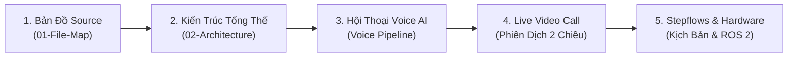

# HỆ THỐNG TÀI LIỆU KỸ THUẬT HC-ROBOT (DOCUMENTATION HUB)

Chào mừng bạn đến với trung tâm tài liệu kỹ thuật của dự án **HC-Robot (Smart Hotel Assistant Robot)**. Tất cả tài liệu hướng dẫn chuyên sâu, kiến trúc hệ thống, quy trình triển khai và bản đồ mã nguồn được chuẩn hóa và quản lý tập trung tại đây.

---

## Thứ Tự Đọc Cho Người Mới Tiếp Nhận (Onboarding Path)

Để nhanh chóng nắm bắt toàn bộ kiến trúc và bắt đầu phát triển dự án mà không bị ngợp, hãy đọc tài liệu theo trình tự 5 bước khuyến nghị sau:

1. **Bước 1: Nắm cấu trúc dự án & vị trí file:** Đọc **[[01-File-Map|Bản Đồ Kiểm Kê Source Code (01-File-Map.md)]]** để biết từng file nằm ở đâu, do ai phụ trách và mức độ xác minh thực tế.
2. **Bước 2: Nắm kiến trúc phân tầng & luồng dữ liệu:** Đọc **[[02-Architecture|Tổng Quan Kiến Trúc Hệ Thống (02-Architecture.md)]]** để hiểu 4 tầng phân tán từ ROS 2 Edge, FastAPI Backend, Robot Kiosk đến Dashboards.
3. **Bước 3: Hiểu luồng giọng nói AI phản xạ tức thì:** Đọc **[[guides/ai_optimization|Hướng Dẫn Tối Ưu Tốc Độ Phản Hồi AI (guides/ai_optimization.md)]]** và **[[guides/langgraph_harness|LangGraph Agent Harness (guides/langgraph_harness.md)]]** để hiểu cơ chế VAD 1800ms, Groq Cloud LLM cascade và Audio Caching.
4. **Bước 4: Hiểu luồng gọi video call có phụ đề & giọng dịch:** Đọc **[[guides/video_call_flow|Luồng Phiên Dịch Video Call (Staff <-> Robot)]]** để nắm cơ chế WebRTC signaling, STT nhận diện song ngữ và hàng đợi âm thanh.
5. **Bước 5: Vận hành kịch bản khách sạn & phần cứng:** Đọc **[[workflows/stepflow|Đặc Tả 8 Core Workflows (Stepflow)]]** và **[[guides/distributed_ros2|Kiến Trúc Mạng ROS 2 Phân Tán]]**.

---

## Danh Mục Tài Liệu Chi Tiết Theo Phân Hệ

### 1. Tổng Quan Hệ Thống & Bản Đồ Mã Nguồn
* **[[01-File-Map|Bản Đồ Kiểm Kê Source Code (01-File-Map.md)]]**:
  * Kiểm kê chi tiết 100% file source code: đường dẫn, trách nhiệm, thành phần chính, nơi sử dụng, note liên quan và mức độ xác minh đối chiếu từ mã nguồn.
* **[[02-Architecture|Tổng Quan Kiến Trúc Hệ Thống (02-Architecture.md)]]**:
  * Mô hình phân tầng (Tier 1: ROS 2 Hardware -> Tier 2: FastAPI Backend -> Tier 3: Robot Kiosk -> Tier 4: Operations Dashboards).
  * Sơ đồ tuần tự tương tác giọng nói, sơ đồ phiên dịch video call hai chiều, vòng đời phiếu nghiệp vụ và chiến lược dự phòng chịu lỗi (Graceful Degradation).

---

### 2. Trí Tuệ Nhân Tạo & Xử Lý Giọng Nói (AI & Voice Pipeline)
* **[[guides/ai_optimization|Hướng Dẫn Tối Ưu Tốc Độ Phản Hồi AI (guides/ai_optimization.md)]]**:
  * Phân tầng 4-Tier LLM Cascade (Groq Cloud -> Gemini Flash -> Ollama Local -> Factsheet).
  * Chuẩn hóa VAD Silence Detection **1800ms** (`SPEECH_FINAL_SILENCE_MS = 1800`) chống cướp lời khách hàng.
  * Multi-tier Audio Caching (RAM LRU + Disk Cache tại `backend/static/audio_cache/`) truy xuất âm thanh tức thì trong 0.6ms.
  * Xử lý giải mã âm thanh Web Audio API trên thiết bị di động khi có tương tác chạm (User Gesture) và chạm ngắt lời (Barge-In).
* **[[guides/langgraph_harness|LangGraph Agent Harness & Tối Ưu Voice Pipeline (guides/langgraph_harness.md)]]**:
  * Kiến trúc StateGraph 5 node (`fast_path`, `intent_router`, `service_fsm`, `retrieval`, `generator`).
  * Cơ chế xác thực số phòng và mã PIN (thay thế thẻ NFC cũ).
* **[[guides/robot_feedback_architecture|Kiến Trúc Thu Thập Đánh Giá & Vòng Đời Hội Thoại (guides/robot_feedback_architecture.md)]]**:
  * Modal đánh giá 5 sao tức thì (3 giây) khi kết thúc phiên hỗ trợ.
  * Tự động cảnh báo tới Concierge Desk khi nhận đánh giá tiêu cực (<= 3 sao).

---

### 3. Phiên Dịch Trực Tiếp & Video Call Hai Chiều (WebRTC Live Call)
* **[[guides/video_call_flow|Luồng Phiên Dịch & Âm Thanh Video Call Staff <-> Robot (guides/video_call_flow.md)]]**:
  * Kiến trúc Signaling WebSocket Hub (`VideoCallManager` tại `backend/app/services/video_call_manager.py`).
  * Chuỗi bước chẩn đoán một câu thoại: `STT_STARTED` -> `COMMITTED` -> `TRANSLATE_REQUEST` -> `TRANSLATED` -> `SUBTITLE_SENT` -> `TTS_REQUEST` -> `TTS_READY` -> `AUDIO_RECEIVED` -> `PLAY_STARTED` -> `PLAY_ENDED`.
  * **Call Audio Stream STT Adapter:** Ghi âm PCM WAV 16kHz gửi lên `/api/v1/ai/stt/transcribe` khắc phục lỗi microphone Web Speech API bị hủy trên thiết bị di động.
  * Phân biệt rõ Input Language (ngôn ngữ câu nói) và Target Language (ngôn ngữ đích của người nghe): Nếu khách nói tiếng Việt cho Staff nghe tiếng Việt thì giữ nguyên, không dịch vòng và không ép đổi chế độ cuộc gọi.
  * Xử lý lỗi `TTS_EMPTY`, cơ chế tự động nhảy tuần tự gói âm thanh (`advanceExpectedSeqOnFailure`) và khóa bảo vệ hàng đợi (`playbackWatchdogRef` 400ms).

---

### 4. Giao Diện Kiosk & Cơ Chế Bảo Mật
* **[[guides/kiosk_security_exit|Cơ Chế Bảo Mật Thoát Kiosk: Secret Multi-Tap (guides/kiosk_security_exit.md)]]**:
  * Triết lý Zero-Exposure UI: Ẩn hoàn toàn nút đăng xuất/thoát ứng dụng khỏi khách hàng thông thường.
  * Cử chỉ bảo mật: Gõ nhanh 5 lần trong vòng 2 giây vào Logo hoặc góc màn hình để kích hoạt Modal xác thực mật khẩu nhân viên.
  * Hỗ trợ phím tắt khẩn cấp: `Ctrl + Shift + L` hoặc `Escape` x3 lần.

---

### 5. Kịch Bản Tương Tác & Nghiệp Vụ Khách Sạn (Workflows & Operations)
* **[[workflows/core_workflows_detailed|Đặc Tả 6 Core Workflows Hệ Thống (workflows/core_workflows_detailed.md)]]**:
  * Tài liệu chi tiết 6 luồng vận hành cốt lõi theo chuẩn slide đồ án: Cấu hình Admin, Đón tiếp & Tư vấn AI, Điều phối dịch vụ khách sạn, Chuyển giao hỗ trợ sang nhân viên (Video Call & Live Translation), Điều hướng tự hành & Dẫn khách (Nav2), và Giám sát đội xe & Tự động sạc đa tầng.
* **[[workflows/stepflow|Đặc Tả 8 Action Blocks & Kịch Bản Stepflows (workflows/stepflow.md)]]**:
  * Định nghĩa 8 Action Blocks chuẩn: `MOVE`, `GREET`, `SPEAK`, `SHOW`, `LISTEN`, `RECOMMEND`, `CREATE_REQUEST`, `FEEDBACK`.
  * Đặc tả chi tiết các kịch bản vận hành khách sạn: Đón tiếp sảnh, Dẫn đường tới vị trí, Dọn buồng phòng, Đặt xe taxi, Phục vụ món tại phòng (Room Service), Báo hỏng & Sửa chữa kỹ thuật (Maintenance), Tuần tra an ninh và Thu thập phản hồi.
  * Kiến trúc SSOT Service Keywords (`constants.py`) đồng bộ danh mục từ khóa giữa kịch bản hệ thống và LangGraph Fast-path.

---

### 6. Điều Hướng Bản Đồ & Phần Cứng ROS 2 (Hardware & Edge)
* **[[guides/hardware_architecture|Đặc Tả Phần Cứng & ROS 2 Edge (guides/hardware_architecture.md)]]**:
  * Bản vẽ kỹ thuật & sơ đồ đấu dây chi tiết: Raspberry Pi 5, ESP32 DevKitC, L298N, 4 Encoders JGA25-370, 4 Cảm biến siêu âm HC-SR04, IMU MPU-9250 và RPLiDAR A1.
  * Phân tách 3 đường nguồn độc lập & tiếp đất sao (Common Star Ground).
  * Giao thức truyền tin Serial JSON Lines 115200 baud giữa ESP32 và Pi 5.
  * Danh mục các ROS 2 Nodes: `odom_encoder_node`, `safety_controller_node` (phanh khẩn cấp <= 0.5m), `motor_driver_node`, `person_detection_node` (YOLOv8n) và `person_fusion_tracker`.
* **[[guides/static-map-navigation|Hướng Dẫn Điều Hướng Bản Đồ Tĩnh (guides/static-map-navigation.md)]]**:
  * Tích hợp bản đồ 2D sảnh khách sạn và quản lý danh sách Waypoints / POIs định danh (Lobby, Reception, Elevator, Restroom, Sofa,...).
* **[[guides/robot_movement_commands|Bảng Tra Cứu Lệnh Di Chuyển, Quét Map & Tự Hành (guides/robot_movement_commands.md)]]**:
  * Bảng đối chiếu các nút trên Frontend Web Admin (Menu COMMANDS) với lệnh Terminal WSL2 tương đương: Quét SLAM, Foxglove, Tự hành Frontier Exploration, Lưu bản đồ, Dẫn đường AMCL/Nav2, Lái xe WASD và Phanh khẩn cấp E-STOP.
* **[[guides/distributed_ros2|Kiến Trúc Mạng ROS 2 Phân Tán (guides/distributed_ros2.md)]]**:
  * Cấu hình CycloneDDS, VPN Tailscale kết nối giữa Laptop NUC và Raspberry Pi 5.
* **[[guides/tailscale_hybrid_deployment_pi5_guide|Hướng Dẫn Triển Khai Tailscale Hybrid Pi 5 (guides/tailscale_hybrid_deployment_pi5_guide.md)]]**:
  * Thiết lập mạng riêng WireGuard P2P (< 5ms) kết hợp Tailscale Funnel phục vụ bản đồ tĩnh ra ngoài Internet qua mã QR.
* **[[guides/ultrasonic_setup|Cấu Hình Cảm Biến Siêu Âm HC-SR04 & ESP32 (guides/ultrasonic_setup.md)]]**:
  * Sơ đồ phần cứng giữa ESP32, L298N và cảm biến siêu âm tránh va chạm khẩn cấp thời gian thực.

---

### 7. Cơ Sở Dữ Liệu & Backend
* **[[guides/alembic_guide|Hướng Dẫn Quản Lý Database Migration Với Alembic (guides/alembic_guide.md)]]**:
  * Quy trình tạo, kiểm tra và chạy database migrations với Alembic & SQLAlchemy.
  * Đồng bộ models với PostgreSQL và xử lý xung đột schema.

---

### 8. Hướng Dẫn Ghi Chép Nhật Ký Phát Triển (Dev Logs)
* **[[dev-logs/README|Quy Chuẩn & Hướng Dẫn Ghi Chép Devlog (dev-logs/README.md)]]**:
  * Không gian lưu trữ nhật ký kỹ thuật, quá trình debug và ghi chú thử nghiệm của lập trình viên.
  * Quy chuẩn đặt tên file theo mốc thời gian `YYYY-MM-DD_<tieu-de>.md` và template bản ghi chuẩn.

---

> **Lưu ý:** Dữ liệu tri thức khách sạn phục vụ tra cứu thông tin (RAG Knowledge Base) của AI Concierge được quản lý riêng tại [backend/knowledge_vault/hotel_facilities_floor_layout_vi.md](../backend/knowledge_vault/hotel_facilities_floor_layout_vi.md).
