# HC-ROBOT (FA26SE905) · SYSTEM ARCHITECTURE & WORKFLOW DIAGRAMS (REVIEW 2)

> **Document purpose:** Complete technical diagrams (Mermaid & PlantUML) corresponding to the Key Design Decisions (D1–D5) and Core Workflows (WF-01–WF-05) in `SWP490_FA26SE905_R2_DesignBrief.md`.

---

## 1. Decision D1: Multi-Tier Hybrid AI Voice Pipeline (FR-AI-01 / Architecture Fig 2.1)

### 1.1. Mermaid Diagram

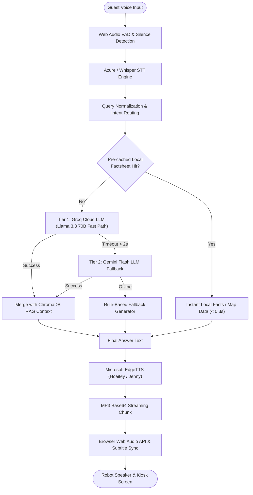

### 1.2. PlantUML Diagram

```plantuml
@startuml
title Decision D1: Multi-Tier Hybrid AI Voice Pipeline (FR-AI-01)
skinparam component {
  BackgroundColor White
  BorderColor #14233A
  FontColor #14233A
}

actor "Hotel Guest" as Guest
component "Web Audio VAD\n& Earcon Chime" as VAD
component "STT Engine\n(Whisper / Azure)" as STT
component "FastAPI AI Engine\n(ai_chat_service.py)" as Backend
database "ChromaDB\nVector Store" as RAG
cloud "Groq Cloud LLM\n(Tier 1 Fast Path)" as Groq
cloud "Gemini Flash API\n(Tier 2 Fallback)" as Gemini
component "EdgeTTS Audio Engine\n(Neural Voices)" as TTS
component "Kiosk Web Audio API\n& Subtitle Sync" as Kiosk

Guest -> VAD : Speaks inquiry
VAD -> STT : Audio buffer streaming
STT -> Backend : Transcribed query string

Backend -> RAG : Query hotel semantic factsheet
RAG -> Backend : Context chunks

alt Fast Path (Tier 1 Groq)
    Backend -> Groq : Prompt + Context (Streaming)
    Groq -> Backend : AI response (< 800 ms)
else Timeout > 2s or Rate Limit
    Backend -> Gemini : Fallback prompt
    Gemini -> Backend : AI response
else Offline Network
    Backend -> Backend : Local rule factsheet fallback
end

Backend -> TTS : Synthesize voice (HoaiMy / Jenny)
TTS -> Backend : Base64 MP3 stream
Backend -> Kiosk : Payload {reply, audio_base64}
Kiosk -> Guest : Play audio + display subtitles synchronously

@enduml
```

---

## 2. Decision D2: Multi-Tier Battery Buffer & Auto-Docking (FR-PWR-02 / Battery State Machine)

### 2.1. Mermaid Diagram

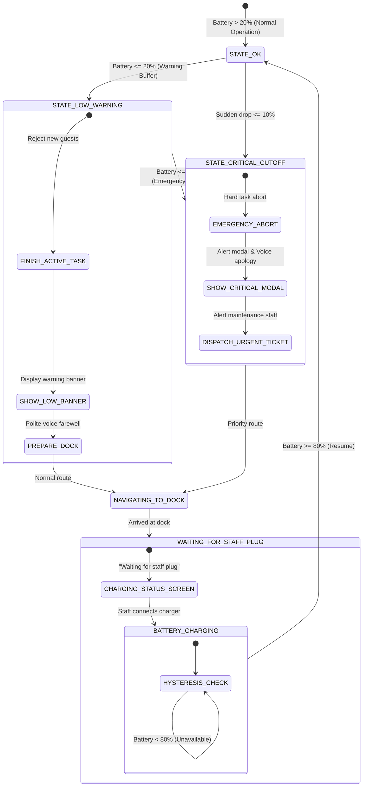

### 2.2. PlantUML Diagram

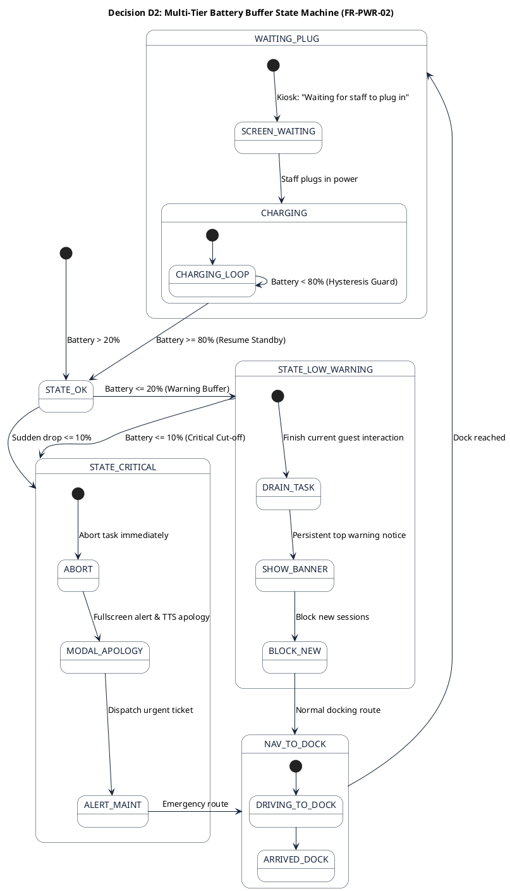

---

## 3. Decision D3: Real-Time Fleet Telemetry & Sensor Health (FR-MON-01 / Telemetry Flowchart)

### 3.1. Mermaid Diagram

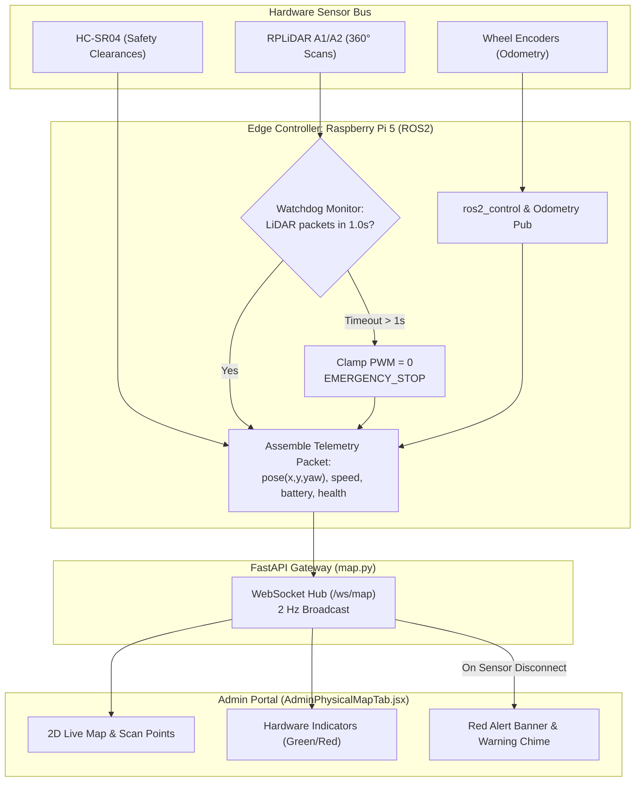

### 3.2. PlantUML Diagram

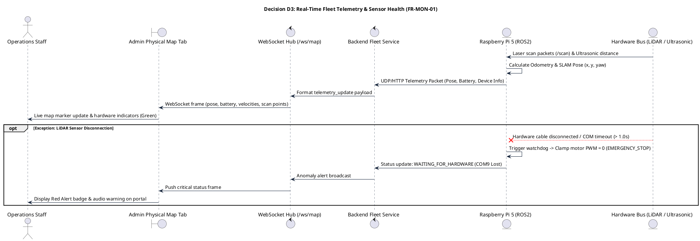

---

## 4. Decision D4: Standardized Core Workflows (WF-01..WF-05)

### 4.1. WF-01: Admin Configuration

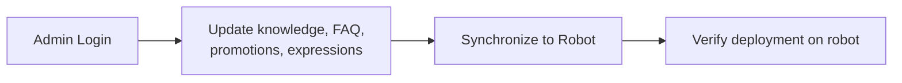

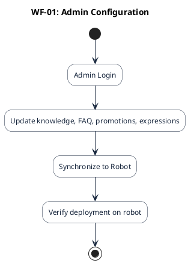

### 4.2. WF-02: Guest Information & Recommendation

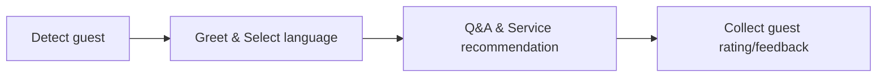

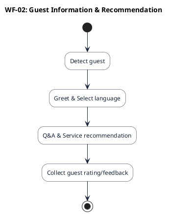

### 4.3. WF-03: Guest Service Request Handling

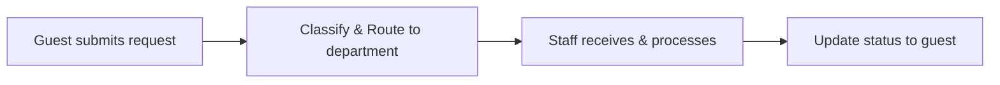

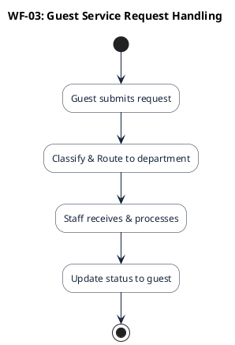

### 4.4. WF-04: Robot-to-Human Handoff

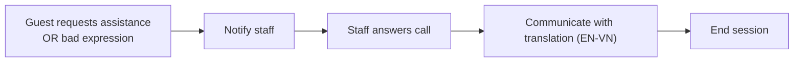

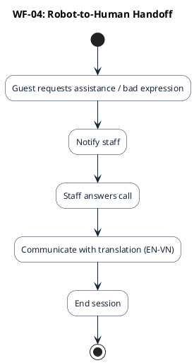

### 4.5. WF-05: Robot Monitoring & Incident Handling

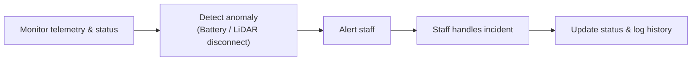

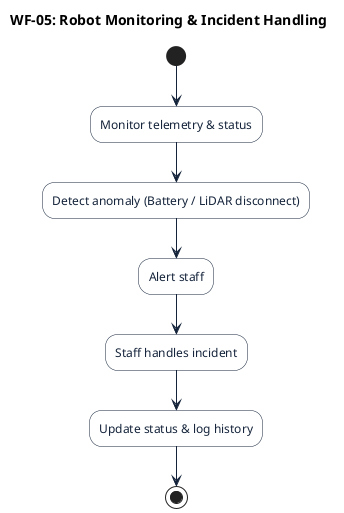

---

## 5. Decision D5: Robot-to-Human WebRTC Video & Translation Architecture (FR-CALL-01)

### 5.1. Mermaid Diagram

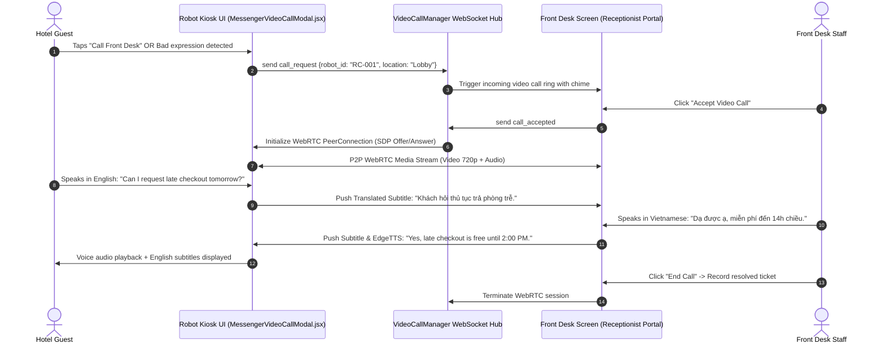

### 5.2. PlantUML Diagram

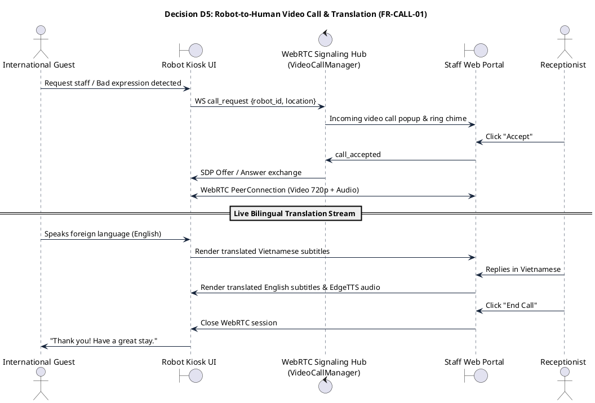
