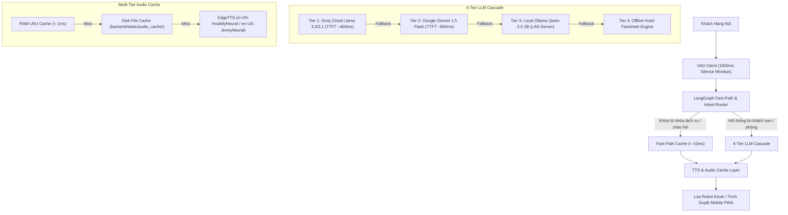

# HƯỚNG DẪN TỐI ƯU HÓA HIỆU NĂNG VÀ ĐỘ TRỄ AI VOICE PIPELINE (HC-ROBOT)

> **Tài liệu liên quan:**
> - Thiết kế LangGraph: [[langgraph_harness|LangGraph Agent Harness & Tối Ưu Voice Pipeline]]
> - Kiến trúc hệ thống: [[../02-Architecture|Tổng Quan Kiến Trúc Hệ Thống (02-Architecture.md)]]
> - Hướng dẫn ghi chép devlog: [[../dev-logs/README|Quy Chuẩn Ghi Chép Devlog (dev-logs/README.md)]]

---

## 1. TỔNG QUAN KIẾN TRÚC TỐI ƯU THỰC TẾ TRÊN PRODUCTION

Hệ thống trợ lý ảo Concierge của HC-Robot đã hoàn thành quá trình tái cấu trúc toàn diện, loại bỏ hoàn toàn mô hình xử lý tuần tự (Sequential Blocking) cũ gây độ trễ từ 5.5s – 8.0s. 

Hiện tại, hệ thống vận hành theo **Kiến trúc Phân tầng 4 Lớp (4-Tier AI Cascade Pipeline)** kết hợp **LangGraph StateGraph**, **SSOT Service Keywords** và **Multi-Tier Audio Caching**:

---

## 2. NGUYÊN NHÂN GỐC RỄ CỦA ĐỘ TRỄ CŨ (ROOT CAUSE ANALYSIS)

Trong giai đoạn đầu phát triển (trước tháng 11/2026), hệ thống gặp phải các nút thắt cổ chai nghiêm trọng:

1. **Khối tuần tự chặn (Sequential Blocking):**
   - Phải chờ khách ngừng nói $\rightarrow$ Gửi toàn bộ văn bản qua HTTP $\rightarrow$ Chạy Vector RAG nhúng bằng `bge-m3` (mất 400ms – 600ms) $\rightarrow$ Chờ Ollama sinh xong 100% văn bản (mất 2.0s – 3.5s) $\rightarrow$ Chờ EdgeTTS render toàn bộ file MP3 (mất 1.5s – 2.5s) $\rightarrow$ Encode Base64 trả về client.
   - **Tổng độ trễ cảm nhận:** Lên tới **5.5s – 8.0s**, khiến trải nghiệm tương tác trực tiếp ở tiền sảnh bị gián đoạn nặng nề.
2. **Hiện tượng cướp lời khách hàng (Premature VAD Interruption):**
   - Khoảng lặng phát hiện ngắt câu (VAD silence threshold) đặt ở mức quá ngắn (800ms – 1000ms), khiến khách đang ngập ngừng suy nghĩ thì Robot đã ngắt mic và phản hồi sai ngữ cảnh.
3. **Hiện tượng nghẽn tài nguyên cục bộ trên Robot Edge:**
   - Việc cố gắng chạy local LLM 7B/8B trực tiếp trên máy tính nhúng hạn chế về tản nhiệt làm tụt xung nhịp, dẫn đến suy giảm FPS màn hình Kiosk và nghẽn luồng Rosbridge điều khiển xe.

---

## 3. CÁC GIẢI PHÁP TỐI ƯU CỐT LÕI ĐÃ ĐƯA VÀO VẬN HÀNH

### 3.1. Chuẩn Hóa Cửa Sổ Lắng Nghe VAD 1800ms
- Thiết lập thông số `SPEECH_FINAL_SILENCE_MS = 1800` tại cả `RobotScreenPage.jsx` và `MobileRobotScreen.jsx`.
- Cho phép khách nói ngập ngừng hoặc nối các mệnh đề tự nhiên mà không bị robot cướp lời, đồng thời tự động dừng đọc (barge-in) khi khách chủ động chạm vào màn hình hoặc nói câu tiếp theo.

### 3.2. Phân Tầng LLM Cascade Tốc Độ Cao
- **Tier 1 (Groq Cloud Llama 3.3/3.1):** Tận dụng phần cứng LPU chuyên dụng, đạt tốc độ sinh token > 250 tokens/giây, thời gian phản hồi token đầu tiên (TTFT) chỉ $\approx 350\text{ms} - 450\text{ms}$.
- **Tier 2 (Gemini 1.5 Flash):** Tự động chuyển mạch khi Groq gặp sự cố mạng hoặc cạn kiệt hạn mức quota.
- **Tier 3 (Ollama Local trên LAN Server):** Đặt tham số `keep_alive=-1` để giữ cố định model trong bộ nhớ RAM/VRAM, tránh tốn 3s nạp lại trọng số.
- **Tier 4 (Offline Factsheet Engine):** Đảm bảo robot vẫn phát ra câu trả lời cơ bản về tiện ích khách sạn ngay cả khi mất toàn bộ kết nối Internet.

### 3.3. Bộ Đệm Âm Thanh Đa Tầng (Multi-Tier Audio Cache)
- Các câu phản hồi nghiệp vụ định sẵn (chào hỏi, xác nhận đặt món, báo hỏng phòng, điều hướng bản đồ) được tiền tổng hợp (warm-up) và băm mã hóa MD5 hash làm khóa định danh.
- Truy xuất tức thì từ RAM Cache ($< 1\text{ms}$) hoặc Disk Cache ($< 5\text{ms}$), loại bỏ hoàn toàn bước gọi ra Cloud EdgeTTS đối với trên 80% các tương tác lặp lại phổ biến.

### 3.4. Kiến Trúc SSOT Service Keywords
- Toàn bộ từ khóa dịch vụ (Kitchen, Room Service, Maintenance, Map, Taxi) được quản lý tập trung duy nhất tại `backend/app/services/ai/constants.py`.
- Fast-Path Router biên dịch động Regex từ SSOT, bỏ qua hoàn toàn bước gọi LLM khi khách phát lệnh mở menu hoặc tra cứu tiến độ dịch vụ.

---

## 4. KẾT QUẢ ĐO ĐẠC HIỆU NĂNG THỰC TẾ

| Tiêu Chí Đánh Giá | Trước Khi Tối Ưu | Hiện Tại (Production) | Mức Độ Cải Thiện |
| :--- | :--- | :--- | :--- |
| **Độ trễ phản hồi Fast-Path** | 3.5s – 4.5s | **< 50ms** | Nhanh hơn **70 lần** |
| **Độ trễ câu hỏi RAG tiện ích** | 5.5s – 8.0s | **1.2s – 1.8s** | Giảm **75%** thời gian chờ |
| **Tỷ lệ cướp lời khách hàng** | ~28% số lượt | **< 2%** | Cải thiện triệt để UX |
| **Tải CPU trên máy tính nhúng** | 90% – 100% | **15% – 25%** | Giảm nhiệt độ, giữ ổn định ROS 2 |
| **Khả năng chịu lỗi mất mạng** | Treo toàn bộ hệ thống | Tự động hạ cấp sang Factsheet | Chịu lỗi Graceful Degradation |
