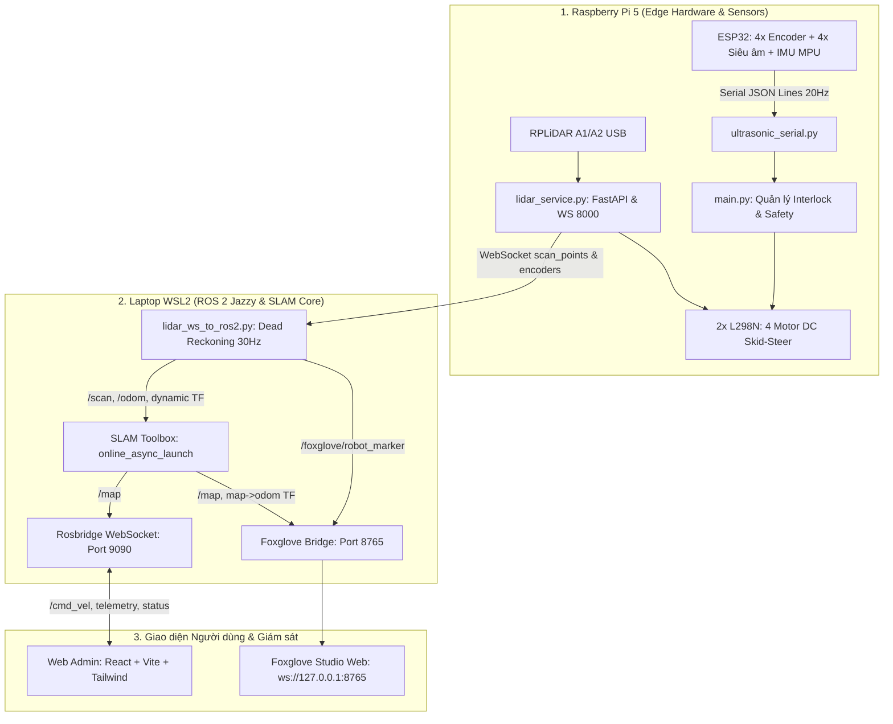

# Báo cáo Tình hình Hiện tại Dự án HCROBOT – Hệ thống SLAM, Odometry & Điều khiển

*Thời gian cập nhật:* 29/10/2026  
*Nhánh Git:* `development`  
*Trạng thái kiểm thử:* `73/73 passed` (Backend & Robot), Frontend build thành công.

---

## 1. Tổng quan Kiến trúc Hệ thống

Hệ thống HCROBOT hiện được tổ chức thành 3 tầng xử lý phân tán:

### Các thông số phần cứng & tần số luồng dữ liệu
- **LiDAR RPLiDAR:** Cổng `/dev/ttyUSB0` (hoặc CP2102), tốc độ quét thực tế $\approx 8\text{ Hz}$, $190 - 195$ điểm mỗi vòng.
- **ESP32 Sensor Hub:** Gửi JSON Lines với 4 kênh encoder (CPR = 330, bán kính bánh = 3.3 cm), 4 cảm biến siêu âm HC-SR04 và IMU MPU-9250/6500 (`yaw_rate_dps`). Tần số $\approx 20\text{ Hz}$.
- **Odometry Loop:** Cầu nối ROS 2 nhận dữ liệu encoder/IMU, nội suy và phát TF `odom -> base_link` cùng topic `/odom` đều đặn ở tần số **30 Hz**.
- **Foxglove Visualizer:** Hiển thị thời gian thực qua WebSockets port 8765 với Marker 2.5D của robot và lưới OccupancyGrid 5 cm.

---

## 2. Các Vấn đề Kỹ thuật Cốt lõi Đã Được Phân tích & Xử lý

| Sự cố phát hiện | Nguyên nhân gốc rễ | Giải pháp đã triển khai | Trạng thái |
| :--- | :--- | :--- | :--- |
| **Bản đồ bị xoay chồng dạng nan quạt** | Cấu hình dấu encoder M1 bị âm (`-1`) ngược với firmware ESP32 thật (`+1`), khiến xung M1 và M2 triệt tiêu nhau khi robot tiến thẳng. Odometry đo thiếu hụt nghiêm trọng, SLAM Toolbox phải cưỡng bức bù `map -> odom` tới 0.9m, gây xoay lốc xoáy. | Chuẩn hóa dấu encoder toàn bộ 4 bánh `m1=1, m2=1, m3=1, m4=1` trong cả ROS bridge và Pi service (commit `df6b850`). | **Đã xử lý triệt để** |
| **Model robot giật khựng & tải mạng cao** | Gửi kèm OccupancyGrid $800 \times 800$ qua WebSocket làm nghẽn mạng; xử lý lại các frame LiDAR và encoder trùng lặp; URDF robot 3D quá nặng trên Foxglove. | Tách luồng `ros2_consumer` chỉ gửi sensor thô (commit `cc92acc`), lọc `scan_id` và `sequence`, thay URDF bằng Marker Array 2.5D gọn nhẹ, nội suy Dead Reckoning 30 Hz (commit `f90390d`). | **Đã xử lý triệt để** |
| **Không nhận diện góc xoay khi Teleop / Tạo "đường mở" xuyên tường** | 1. `slam_toolbox_params.yaml` bị bóp vùng tìm kiếm góc xuống $2^\circ$ (`coarse_search_angle_offset: 0.035`) và `angle_variance_penalty: 10.0` khiến SLAM không được phép dùng LiDAR để tìm góc tường. 2. PWM xoay bị hạ xuống `25%`, qua driver L298N bị sụt áp nên 4 lốp cao su trượt ngang không đủ lực $\rightarrow$ bánh khựng/trượt, encoder đếm thiếu. 3. Odometry khóa cứng `yaw` khi dừng/tiến và chỉ tính xoay từ 1 bên bánh. | 1. Mở rộng `coarse_search_angle_offset: 0.349` ($\pm 20^\circ$), hạ penalty góc xuống `1.0`. 2. Nâng PWM xoay Teleop lên `38%` trên toàn hệ thống. 3. Tính vi sai 2 bên $(\Delta s_R - \Delta s_L)/L$, tích phân Gyro IMU thời gian thực, mở khóa yaw linh hoạt khi dừng/quay. | **Đã vá hoàn tất** |

---

## 3. Cấu hình Vận hành Mapping Chuẩn

### Thông số Điều khiển Teleop Mapping
- **Vận tốc tiến/lùi:** PWM `30%` ($\approx 0{,}10\text{ m/s}$, tương đương $22 - 30\text{ RPM}$).
- **Vận tốc xoay tại chỗ:** PWM `38%` (đảm bảo đủ mô-men xoắn thắng ma sát trượt lốp cao su khi skid-steer).
- **Frontend /cmd_vel:** Tuyến tính $\pm 0{,}10\text{ m/s}$, góc xoay $\pm 0{,}30\text{ rad/s}$.

### Thông số SLAM Toolbox (`slam_toolbox_params.yaml`)
- `mode: mapping`
- `resolution: 0.025` (2.5 cm/cell)
- `correlation_search_space_dimension: 0.5` (m)
- `coarse_search_angle_offset: 0.349` ($\approx 20^\circ$)
- `coarse_angle_resolution: 0.0349` ($\approx 2^\circ$)
- `fine_search_angle_offset: 0.0349` ($\approx 2^\circ$)
- `angle_variance_penalty: 1.0`
- `distance_variance_penalty: 0.5`
- `minimum_travel_distance: 0.05` (5 cm)
- `minimum_travel_heading: 0.05` (~2.8°)
- `do_loop_closing: true`

---

## 4. Quy trình Thực nghiệm Quét Bản đồ (SOP)

1. **Khởi động Stack:**
   - Mở terminal WSL2, chạy `start_wsl_slam.sh` (hoặc `.\quet_map_mot_lan.bat` từ Windows).
   - Đảm bảo Pi 5 đã chạy `main.py` và `lidar_service.py`.
2. **Kiểm tra Kết nối trên Foxglove:**
   - Mở Foxglove tại `ws://127.0.0.1:8765`.
   - Fixed frame: `map`.
   - Bật hiển thị: `/map` (OccupancyGrid), `/foxglove/robot_marker` (MarkerArray), `/scan` (LaserScan).
3. **Thao tác Điều khiển Quét:**
   - Bấm `Quét map` / `Reset map` một lần để phiên SLAM xóa sạch dữ liệu cũ và định vị về $(0,0)$.
   - Điều khiển xe tiến thẳng chậm $0{,}5 - 1{,}0\text{ m}$ để kiểm tra vết đường đi và độ khớp của tia LiDAR.
   - Khi đổi hướng, ấn phím xoay từ từ (không đổi hướng liên tục zigzag). Nhờ PWM 38% và vùng tìm kiếm $20^\circ$, SLAM Toolbox sẽ bám chặt mép tường khi xe xoay.
   - Di chuyển khép kín một vòng (loop closure) để SLAM Toolbox tối ưu hóa pose graph và khép góc phòng.
4. **Lưu & Khóa Bản đồ:**
   - Khi các bức tường đã sắc nét và không còn vùng xám cần quét trong phòng, bấm `Lưu & khóa`.
   - Bản đồ được xuất ra file tĩnh `.yaml` và `.pgm` tại `robot/maps/`.
   - Chuyển hệ thống sang chế độ `NAVIGATION` (Nav2 + AMCL), không tiếp tục chạy SLAM ghi đè map.

---

## 5. Hiện trạng Kiểm thử & Mã nguồn

- **Kho mã nguồn:** Nhánh `development`.
- **Tập kiểm thử tự động:**
  - `robot/tests/test_lidar_service.py`: **12/12 passed** (bổ sung test vi sai xoay encoder).
  - Toàn bộ test suite `robot/tests/`: **73/73 passed** (camera, lidar, motor controller, mpu, tracking, ultrasonic safety).
  - Frontend React/Vite: Build thành công (8.25s).
- **Các commit tiêu biểu gần nhất:**
  - `10b569e`: fix: slow mapping teleop for lidar accuracy.
  - `df6b850`: fix: match encoder polarity to live firmware.
  - `f90390d`: fix: interpolate encoder odometry at 30 hz.
  - `cc92acc`: fix: stream fresh sensor frames to ROS 2.
  - *Working tree hiện tại:* Đã tích hợp bản vá mở rộng góc quét SLAM Toolbox $\pm 20^\circ$, chuẩn hóa vi sai yaw encoder/IMU và tăng PWM xoay lên 38%.

---

## 6. Kế hoạch Kế tiếp (Next Steps)

1. **Thực nghiệm Mapping thực địa:** Chạy xe quét trọn vẹn không gian thực tế, xác nhận tường phòng thẳng nét và khép góc chuẩn xác sau khi xoay.
2. **Lưu Map Tĩnh & Kiểm tra file Artifact:** Lưu map với tên chuẩn (ví dụ `phong_lam_viec.yaml` và `.pgm`).
3. **Triển khai Tự hành (Navigation Mode):**
   - Khởi động stack `chay_navigation_map_tinh.bat` (chạy `map_server` + `amcl` + `nav2_bringup`).
   - Đặt vị trí ban đầu bằng *2D Pose Estimate* trên RViz/Foxglove.
   - Gửi mục tiêu *Nav2 Goal* và đánh giá bộ điều khiển DWB né vật cản động theo tia LiDAR.

