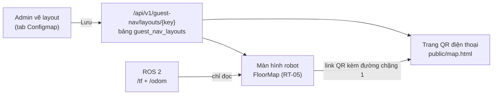

# Configmap — Bản đồ chỉ đường 2D cấu hình bởi Admin

Tab **Configmap** trong Admin Portal cho phép Admin tự vẽ bản đồ chỉ đường 2D cho từng tầng của khách sạn. Bản đồ này thay cho các ảnh mặt bằng cố định (`frontend/public/maps/floor_*.png`) ở hai nơi:

- **Màn hình robot** (trạng thái RT-05, component `FloorMap`) khi khách hỏi đường.
- **Trang QR trên điện thoại** (`frontend/public/map.html`) khi khách quét mã để mang lộ trình theo.

Luồng cũ được giữ nguyên: nhận diện câu hỏi → mở bản đồ 2 chặng → tạo mã QR có hạn 15 phút. Configmap chỉ thay **nền bản đồ và đường đi**. Tầng nào chưa vẽ thì tự dùng lại ảnh và đường cũ.

> Phía robot (ROS 2, Nav2, file map trong `robot/maps`, bảng waypoint/zone) **không bị sửa**. Web chỉ đọc vị trí robot và đọc file map.

---

## 1. Tổng quan

| Khái niệm | Ý nghĩa |
|---|---|
| **Tầng Trệt** | Nơi robot đứng. Dùng **map Nav2 robot đang nạp** (mặc định `mapchinh`) làm khung toạ độ. |
| **7 tầng còn lại** | B2, B1, Tầng 2 → 6. Vẽ trên khung trống theo mét (mặc định 30 × 20 m; bản phác thảo 36,8 × 23,5 m). |
| **Chặng 1** | Robot → Thang máy A, vẽ trên Tầng Trệt. Điểm xuất phát là **vị trí thật của robot**. |
| **Chặng 2** | Thang máy → điểm đến, vẽ trên tầng đích. |
| **Điểm đến** | Ký hiệu gắn **mã có sẵn** trong hệ thống (`room_301`, `spa`, `locker_room`…). |

Danh sách 8 tầng và tên tầng lấy theo knowledge base RAG `backend/knowledge_vault/hotel_facilities_floor_layout_rag.md`.



---

## 2. Hướng dẫn sử dụng cho Admin

Vào **Admin Portal → Configmap**.

### 2.1 Chọn tầng
Ô chọn ở góc trên trái có đúng 8 tầng. Tầng Trệt hiện kèm tên map robot (ví dụ `Tầng Trệt · Sảnh & Tiếp Tân · map robot: mapchinh`).

### 2.2 Công cụ

| Công cụ | Cách dùng |
|---|---|
| **Chọn** | Kéo để di chuyển; kéo chấm xanh để đổi cỡ; ô bên phải để nhập toạ độ/kích thước (mét) và góc. |
| **Vẽ tường** | Bấm từng điểm, **Enter** để xong, **Backspace** bỏ điểm, **Esc** huỷ. Có tuỳ chọn *Khoá góc 90°*. |
| **Tẩy nền** *(chỉ Tầng Trệt)* | Kéo để xoá chấm nhiễu trên nền map Nav2; chế độ *Khôi phục* để vẽ lại; *Khôi phục hết* để trả nền gốc. Chỉ ảnh hưởng hiển thị. |
| **Nền map Nav2** *(chỉ Tầng Trệt)* | Ẩn/hiện lớp map robot làm nền để đồ theo. |
| **Kích thước** *(tầng khác)* | Chiều rộng × dài tầng (mét). |
| **Sao chép từ tầng…** *(tầng khác)* | Chép tường, cửa, nội thất từ tầng khác (kể cả Tầng Trệt). Điểm đến giữ vị trí nhưng bỏ mã để chọn lại. |
| **Phác thảo từ map cũ** *(tầng khác)* | Dựng sẵn bản vẽ theo ảnh mặt bằng cũ: tường, cửa, icon, thang máy, điểm đến đã gắn mã. |

### 2.3 Phím tắt

| Phím | Tác dụng |
|---|---|
| `Ctrl+Z` | Hoàn tác (đang vẽ tường thì bỏ điểm vừa bấm) |
| `Ctrl+Y` / `Ctrl+Shift+Z` | Làm lại |
| `R` / `Shift+R` | Xoay 90° |
| `F` | Lật ngang (đảo chiều chữ L) |
| `Ctrl+D` | Nhân bản |
| `Delete` | Xoá |
| Phím mũi tên (giữ `Shift` = 5 ô) | Dịch vật thể |

Lịch sử hoàn tác giữ tối đa 100 bước; một lần kéo chuột tính là một bước.

### 2.4 Thư viện ký hiệu

| Nhóm | Ký hiệu |
|---|---|
| Khu vực | Phòng/khu vực, Nhãn chữ, **Điểm đến** |
| Di chuyển | **Thang máy**, Cầu thang, Thang cuốn, **Cửa**, **Cửa đôi**, Lối thoát hiểm |
| Tiện ích | WC chung, WC nam, WC nữ, Quầy lễ tân, Trạm sạc robot |
| Nội thất | Bàn chữ nhật, Bàn tròn, Ghế, Sofa chữ L, Quầy chữ L, Cây xanh, Giường, Tủ đồ (locker) |
| Dịch vụ | Hồ bơi, Gym, Spa, Bar, Cà phê, Karaoke, Cửa hàng, Bếp, Kho |
| Bãi xe | Ô đỗ xe (P), Ô tô, Xe máy |

Tất cả là SVG tự vẽ trong `guestNavSymbols.jsx`, không phụ thuộc thư viện icon ngoài.

### 2.5 Những ký hiệu có ý nghĩa khi tính đường

| Ký hiệu | Vai trò |
|---|---|
| **Thang máy** | Đích của chặng 1 (Tầng Trệt) và điểm xuất phát của chặng 2 (tầng khác). Mỗi tầng nên có **đúng 1** icon. |
| **Điểm đến** | Phải chọn mã ở ô *Điểm đến (mã có sẵn)*; mỗi mã chỉ đặt 1 lần. Nhãn tự điền theo mã. |
| **Cửa / Cửa đôi** | Mở khe qua tường. Tâm cửa phải nằm trên hoặc sát tường (lệch < ~25 cm). Phòng có tường kín mà thiếu cửa thì không có đường vào. |
| **Tường** | Vật cản. |
| Quầy, bàn, sofa, cầu thang, thang cuốn | Vật cản (đường đi vòng qua). |
| Ghế, cây, nhãn, icon dịch vụ… | Chỉ để hiển thị, không chặn đường. |

### 2.6 Kiểm tra trước khi lưu
Khi không chọn gì, cột bên phải có **Xem thử đường đi**: mỗi điểm đến hiện độ dài đường (xanh) hoặc **Không có đường** (đỏ, kèm lý do thường gặp). Bấm vào một điểm để xem đường trên bản vẽ.

### 2.7 Lưu, nháp, xoá
- **Lưu & áp dụng**: ghi lên server. Màn hình robot và trang QR dùng ở lần chỉ đường tiếp theo.
- **Nháp tự động**: thay đổi chưa lưu được giữ trong trình duyệt (localStorage, theo từng tầng). Mở lại sẽ có thông báo *Đã khôi phục bản vẽ chưa lưu*.
- **Tải lại** (↻): bỏ nháp, nạp lại bản đã lưu.
- **Xoá layout**: xoá trên server; tầng đó quay về map cũ.

> Layout lưu **trước** khi có tính năng QR (trường `guestView`) cần **lưu lại một lần** để trang QR dùng được.

---

## 3. Kiến trúc kỹ thuật

### 3.1 Hệ toạ độ
- Mọi layout lưu theo **mét**.
- **Tầng Trệt:** frame `map` của Nav2. Đổi sang ô ảnh PGM theo đúng quy ước map_server:
  `cx = (x − origin_x) / resolution`, `cy = height − (y − origin_y) / resolution`.
  Vì vậy layout, vị trí robot và đường đi trùng nhau mà **không cần hiệu chỉnh**.
- **Tầng khác:** gốc (0,0) ở góc dưới-trái tầng, y hướng lên; lưới tính đường 10 cm/ô (`FLOOR_GRID_RES`).
- **Trang QR:** khung cố định **1840 × 1174 px** (bằng ảnh cũ). Layout được co giãn, căn giữa vào khung này (`guestFrame.js`).

### 3.2 Vị trí robot (chỉ đọc)
`useRobotMapPose` subscribe qua rosbridge (`VITE_ROSBRIDGE_URL`, mặc định `ws://127.0.0.1:9090`):
- `/tf` lấy biến đổi `map → odom`, `/odom` lấy `odom → base_link`, ghép bằng `composeMapPose` giống tab Physical Map.
- Mất tín hiệu quá 3 giây ⇒ bỏ vị trí ⇒ chặng 1 quay về map cũ.

Map Nav2 đang nạp lấy từ `GET /api/v1/map/ros2/runtime` (`active_map`); không có thì dùng `VITE_GUEST_NAV_MAP` hoặc `mapchinh`.

### 3.3 Tính đường
- **Tầng Trệt:** lưới từ chính file `.pgm` của Nav2 (`buildWalkableGrid`), nở vật cản 10 cm.
- **Tầng khác:** `rasterizeLayout` biến tường + nội thất lớn thành ô cấm, nở 15 cm, rồi **mở khe** tại cửa.
- **A\*** 8 hướng (binary heap) trong `findGridPath`, có **phạt chi phí khi đi gần tường** dựa trên bản đồ khoảng cách (`distanceField`). Đường ưu tiên giữa hành lang (~0,6 m với tầng khách sạn, ~0,3 m với phòng lab) và đi giữa khe cửa.
- Bước làm thẳng đường chỉ cắt chéo khi vẫn giữ khoảng cách với tường; cuối cùng bo góc (`roundedPath`).

### 3.4 Thứ tự ưu tiên khi hiển thị (màn hình robot)

| Chặng | Ưu tiên 1 | Ưu tiên 2 | Dự phòng |
|---|---|---|---|
| Chặng 1 | Layout Tầng Trệt + vị trí robot → icon Thang máy | Map Nav2 đã làm gọn + vị trí robot → waypoint "Thang máy" | Ảnh `floor_1.png` + đường cố định cũ |
| Chặng 2 | Layout tầng đích: thang máy → icon điểm đến cùng mã | — | Ảnh `floor_*.png` + `routeTarget` cũ |
| Điểm đến ở Tầng Trệt | Layout Tầng Trệt: robot → icon điểm đến | — | Đường cố định cũ |

### 3.5 Trang QR (`public/map.html`)
Cơ chế cũ giữ nguyên: token base64 `{d, e, n}` hết hạn 15 phút, tham số dự phòng `dest`, chọn host Wi-Fi/Tailscale, xoay bản đồ theo hướng đi, zoom/kéo, chuyển chặng.

Phần thêm:
1. Khi Admin lưu, editor tạo **`guestView`** (`guestView.jsx`): SVG của layout đã quy về khung 1840 × 1174, cùng đường **thang máy → từng điểm đến** tính sẵn. Điện thoại không phải tính đường.
2. Kiosk gắn vào link QR hai tham số:
   - `nm`: map Nav2 của Tầng Trệt.
   - `l1`: đường chặng 1 từ vị trí robot, dạng `x,y;x,y;…` theo px khung QR.
   Cả hai mã QR trên kiosk (trong bản đồ và ở cột phải) đều mang tham số này.
3. `map.html` nạp `guestView` của Tầng Trệt (nếu có `nm` + `l1`) và của tầng đích. Có thì ẩn ảnh cũ, chèn layout vào `<g id="layoutLayer">` và dùng đường mới; không có thì giữ nguyên ảnh và đường cũ. SVG có dấu hiệu script bị bỏ qua.

Ví dụ link:
```
http://<host>:8000/map.html?t=<token>&dest=room_301&nm=mapchinh&l1=556,754;616,661;…;1440,528
```

---

## 4. Đồng bộ với RAG

Nguồn: `backend/knowledge_vault/hotel_facilities_floor_layout_rag.md` (mục 1 và mục 10 *Quick Lookup Master Table*).

| Nội dung | Đồng bộ ở đâu |
|---|---|
| 8 tầng và tên tầng | Ô chọn tầng trong Configmap (`HOTEL_FLOORS`) |
| Điểm đến từng tầng | `HOTEL_DESTINATIONS` (FloorMap.jsx) và `DESTINATIONS` (map.html) — phải giống nhau |
| Hướng dẫn chặng 2 | `step2Text` (FloorMap) / `step2` (map.html) theo cột *Navigation & Directions* |
| Bộ chọn nhanh điểm đến | `HOTEL_KEY_FACILITIES` (14 điểm) |
| Nhận diện câu hỏi | `detectDestinationPoi` |

Đã chỉnh để khớp RAG:
- Thêm điểm đến **Phòng Thay Đồ & Tắm (`locker_room`, Tầng 5)**.
- Rooftop Coffee "rẽ trái"; Sky Lounge Bar "rẽ trái ~10m"; Karaoke "đi thẳng sang cánh phải".
- Tầng 2 không gọi là "nhà hàng" (RAG: không có nhà hàng, chỉ Room Service 24/7).
- Phòng nghỉ 301–310 và 401–410.

**Khi thêm/sửa một điểm đến**, cập nhật cùng lúc: file RAG → `HOTEL_DESTINATIONS` → `DESTINATIONS` trong `map.html` → từ khoá trong `detectDestinationPoi` (nếu cần) → đặt icon Điểm đến trong Configmap và Lưu.

---

## 5. API

Router `backend/app/api/v1/endpoints/guest_nav_layout.py`, prefix `/api/v1/guest-nav`. Bảng `guest_nav_layouts` (model `GuestNavLayout`), tạo tự động khi backend khởi động.

| Method | Đường dẫn | Quyền | Mô tả |
|---|---|---|---|
| `GET` | `/layouts/{key}` | Công khai | Lấy layout; `404` nếu chưa có |
| `PUT` | `/layouts/{key}` | Admin | Lưu layout |
| `DELETE` | `/layouts/{key}` | Admin | Xoá layout |

`key` = map id Nav2 (Tầng Trệt, ví dụ `mapchinh`) hoặc `floor-<floorId>` (ví dụ `floor-5` = Tầng 3). Quyền Admin kiểm tra ở server (`default_dashboard == "admin_portal"`), không có token ⇒ `401`, không phải Admin ⇒ `403`.

Payload `PUT`:
```json
{
  "version": 1,
  "width": 36.8, "height": 23.5,
  "walls": [{ "id": "wall-1", "points": [[0.5, 0.5], [36.3, 0.5]], "thickness": 0.15 }],
  "objects": [{ "id": "obj-1", "type": "destination", "destKey": "room_301",
                "x": 33.1, "y": 17.5, "w": 1.2, "h": 1.2, "rotation": 0, "flip": false, "label": "301" }],
  "erased": [],
  "guestView": { "version": 1, "frame": {"width": 1840, "height": 1174}, "svg": "<g …>", "routes": { "room_301": { "d": "M …", "start": {"x":0,"y":0}, "end": {"x":0,"y":0}, "lengthM": 7.1 } } }
}
```
- `width`, `height`: chỉ dùng cho tầng khác.
- `erased`: chỉ số ô nền Nav2 đã tẩy, chỉ dùng cho Tầng Trệt.
- `guestView`: do editor tạo, tối đa 2 MB.
- Giới hạn khác: 400 tường, 800 vật thể, loại vật thể theo danh sách cho phép.

---

## 6. Bản đồ mã nguồn

| File | Vai trò |
|---|---|
| `frontend/src/pages/admin/tabs/AdminGuestNavMapTab.jsx` | Editor (tab Configmap) |
| `frontend/src/components/robot/guestNavSymbols.jsx` | Thư viện ký hiệu SVG, đổi toạ độ mét ↔ ô, lớp vẽ layout |
| `frontend/src/services/layoutRouting.js` | Dựng lưới từ layout, mở khe cửa, `routeOnGrid` |
| `frontend/src/services/robotFloorPose.js` | Vị trí robot từ ROS, nạp map Nav2, A\*, distance field, làm gọn nền |
| `frontend/src/services/floorSketches.js` | Bản phác thảo 7 tầng từ ảnh cũ |
| `frontend/src/services/guestFrame.js` | Khung 1840 × 1174 của trang QR |
| `frontend/src/services/guestView.jsx` | Tạo `guestView` khi lưu |
| `frontend/src/services/guestNavLayoutApi.js` | Gọi API |
| `frontend/src/components/robot/FloorMap.jsx` | Màn hình chỉ đường; chọn layout/fallback; gắn `nm`/`l1` vào link QR |
| `frontend/src/pages/robot/RobotScreenPage.jsx` | Mã QR cột phải nhận đường chặng 1 từ FloorMap |
| `frontend/public/map.html` | Trang QR điện thoại |
| `frontend/src/pages/admin/AdminPortal.jsx` | Menu tab Configmap |
| `backend/app/api/v1/endpoints/guest_nav_layout.py`, `backend/app/models/guest_nav_layout.py` | API + bảng |

---

## 7. Kiểm thử

```powershell
cd frontend
npx vitest run src/services
```

| File test | Nội dung |
|---|---|
| `robotFloorPose.test.js` | Công thức toạ độ map_server; A\* vòng qua tường |
| `layoutRouting.test.js` | Phòng kín không có đường; có cửa thì đi qua cửa; quầy chắn ⇒ đường vòng; đi giữa hành lang |
| `floorSketches.test.js` | 7 bản phác: đủ điểm đến của tầng và đều tới được từ thang máy |
| `detectDestination.test.js` | Câu hỏi → mã điểm đến; yêu cầu mang đồ lên phòng không bị coi là hỏi đường |

Kiểm tra thủ công không cần robot: chạy một rosbridge giả phát `/tf` (map→odom) và `/odom` ở cổng 9090, mở `/robot` → menu Tiện ích → Chỉ đường; đọc link QR và mở trên trình duyệt.

---

## 8. Giới hạn hiện tại

- Chưa thử với robot thật và chưa thử bằng giọng nói thật (chỉ thử bằng rosbridge giả và menu).
- Chữ trong layout trên trang QR xoay theo bản đồ (giống ảnh cũ).
- Nếu tầng có nhiều icon Thang máy, chỉ icon đầu tiên được dùng.
- Đổi map Nav2 (quét lại) thì phải vẽ lại / chỉnh layout Tầng Trệt.
- Trang QR cần layout đã lưu cùng `guestView`; layout cũ phải lưu lại một lần.
- File RAG tự mâu thuẫn ở tên Tầng 4 ("Standard" ở mục 1, "Deluxe" ở mục 10).
