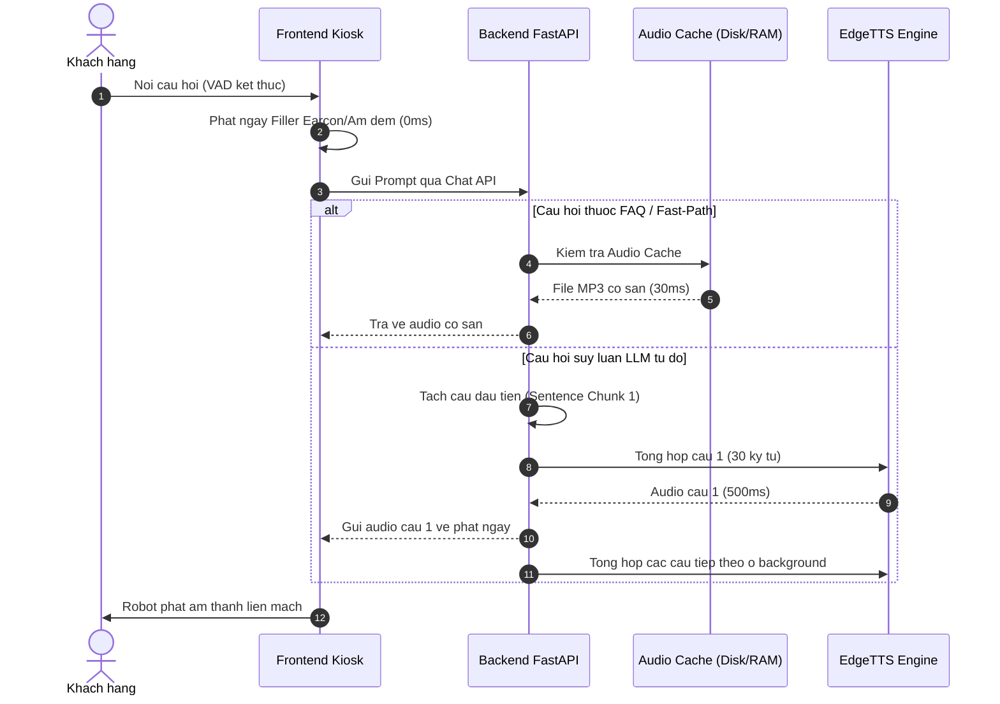

# Kien Truc Toi Uu Toc Do TTS Khong Thay Doi Giong Noi (Fast Consistent Voice Architecture)

## 1. Tong Quan Muc Tieu

Doi voi he thong Robot le tan khach san 5 sao (HC-Robot Concierge), hai yeu to quan trong nhat cua giong noi la:
1. **Tinh dong nhat ve am sac (Voice Consistency):** Giu co dinh 100% giong nu nhe nhang tieu chuan:
   - Tieng Viet: `vi-VN-HoaiMyNeural`
   - Tieng Anh: `en-US-JennyNeural`
   - Tuyet doi khong tu y doi sang giong nam hoac giong doc may moc khac khi gap loi.
2. **Do tre phan xa hoi thoai thap (Low Conversational Latency):**
   - Thoi gian tu khi khach ngung noi den khi Robot cat tieng phat am phai dat duoi **1.0 giay**.
   - Khong bi dung hinh hoac timeout (15s - 18s) khi mang Internet quoc te cham.
   - Khong bat buoc phai phu thuoc vao tai khoan the thanh toan quoc te cua Azure.

---

## 2. Phan Tich Nguyen Nhan Gay Tre O He Thong Hien Tai

Chu trinh phan hoi hoi thoai blocking truyen thong:
```text
Khach noi xong -> Gui STT len Backend -> LLM sinh xong toan bo Text (300 ky tu) -> Backend gui ca 300 ky tu vao EdgeTTS -> Cho tai het toan bo audio MP3 -> Gui ve Frontend -> Robot bat dau noi.
```

Diem nghen:
- **Kich thuoc van ban qua dai:** Doan hoi thoai 250 - 300 ky tu can thoi gian tong hop va truyen tai stream tu 4 den 10 giay tren mang cong cong.
- **Xu ly tuan tu (Sequential Blocking):** Khach phai cho xong ca 2 khau (LLM + TTS tong) moi duoc nghe bat ky am thanh nao.
- **Rui ro nghen WebSocket quoc te:** Microsoft EdgeTTS dat cum may chu tai nuoc ngoai, ket noi WebSocket co the bi delay DNS hoac IPv6 stalling tren duong truyen Viet Nam.

---

## 3. Cac Giai Phap Ky Thuat Chi Tiet

### Giai Phap 1: First-Sentence Synthesis & Streaming Playback (Phat Cau Dau Tien Truoc)

#### Nguyen ly hoat dong
Thay vi cho doi LLM sinh xong toan bo 3 - 4 cau (khoang 250 - 300 ky tu) roi moi bat dau tong hop TTS:
1. Ngay khi LLM sinh xong **cau dau tien** (khoang 20 - 40 ky tu, ngan cach boi dau `.`, `!`, `?` hoac `\n`):
   - Vi du: *"Da vang, khach san co ho boi vo cuc tai tang 5 nhe a."*
2. Backend lap tuc gui cau ngan nay vao EdgeTTS de tao file audio MP3 rieng cho cau 1.
3. EdgeTTS tao audio cho cau ngan chi mat **400ms - 700ms**.
4. Frontend nhan duoc audio cau 1 va phat ngay cho khach nghe.
5. Trong luc khach dang lang nghe cau 1 (thoi gian noi thuc te keo dai 2.5 - 3.5 giay), Backend tiep tuc tong hop ngam cac cau con lai o duoi nen (Background Chunking).
6. Khi cau 1 ket thuc, audio cau 2 da san sang trong bo nho dem de phat tiep tuc ma khong bi ngat quang.

#### Danh gia ky thuat
- **Giong noi:** Giu nguyen 100% `vi-VN-HoaiMyNeural`.
- **Do tre cam nhan (Perceived Latency):** Giam tu **6s - 12s** xuong con **800ms - 1.2s**.
- **Chi phi:** Hoan toan mien phi, khong can API Key.

---

### Giai Phap 2: Instant Audio Filler / Earcon Acknowledgment (Am Phan Xa Tuc Thi 0ms)

#### Nguyen ly hoat dong
Trong giao tiep thuc te giua nguoi voi nguoi, khi nghe xong mot cau hoi, nguoi le tan thuong phan xa ngay lap tuc bang mot tu dem (*"Da"*, *"Da vang a"*, *"Em nghe a"*, *"Da de em kiem tra a"*) truoc khi tra loi chi tiet.

He thong ap dung ky thuat tuong tu cho Robot:
1. Ngay khi SpeechRecognition phat hien khoanh khac im lang (khach vua noi xong):
2. Frontend lap tuc phat ngay mot am thanh phan xa cuc ngan tu Offline Audio Cache:
   - Am chuong xac nhan nhe nhang (Chime Earcon).
   - Hoac am thanh giong Hoai My thu san: *"Da vang a"*, *"Da em day a"*.
3. Thoi gian phat am thanh dem bat dau tai thoi diem **0ms** (khong ton thoi gian mang vi luu san trong RAM/IndexedDB).
4. Doan audio dem ngan keo dai khoang **800ms - 1.2 giay**.
5. Trong luc doan dem dang phat, Backend thuc hien xong Fast-Path/LLM va tong hop cau tra loi chinh.
6. Khi doan dem vua dut, cau tra loi cua Robot lap tuc vang len.

#### Danh gia ky thuat
- **Giong noi:** Giu nguyen 100% giong Hoai My.
- **Do tre cam nhan:** **0ms** (Khach thay Robot phan ung ngay khi vua buong loi, triet tieu hoan toan khoang lang chet).
- **Chi phi:** Hoan toan mien phi.

---

### Giai Phap 3: Pre-synthesized Hot FAQ & Business Cache (Luu Dem San Am Thanh FAQ)

#### Nguyen ly hoat dong
Trong hoat dong van hanh khach san thuc te, 70% den 80% cau hoi cua khach roi vao cac chu de co dinh:
- Gio nhan phong / tra phong (Check-in / Check-out).
- Mat khau Wi-Fi.
- Vi tri ho boi, phong gym, nha hang buffet, spa.
- Mo menu mon an, do uong.
- Goi xe taxi, ho tro hanh ly.
- Gioi thieu ban than cua Robot Rora.

Thay vi bat ky lan hoi nao cung goi EdgeTTS tong hop lai:
1. Backend chay tien trinh khoi tao (Pre-warm Task) khi he thong khoi dong.
2. Sinh san toan bo file am thanh MP3 voi giong `vi-VN-HoaiMyNeural` cho danh muc cac cau tra loi tren.
3. Luu truc tiep cac file am thanh vao thu muc `backend/static/audio_cache` voi khoa dinh danh Hash:
   `Key = MD5(cleaned_text + voice_id + rate + volume)`
4. Khi khach hoi, Redis / Cache Node nhan dien Intent va tra ve ngay duong dan am thanh san co.

#### Danh gia ky thuat
- **Giong noi:** Chuan 100% Hoai My, chat luong am thanh cao nhat.
- **Do tre:** Chi tu **30ms den 60ms** (nhanh nhu doc file cuc bo).
- **Do tin cay:** 100% khong bao gio bi timeout vi khong can goi ra Internet luc khach dang hoi.

---

### Giai Phap 4: WebSocket Connection Pooling & Pre-warmed Session

#### Nguyen ly hoat dong
Thu vien `edge_tts` thong thuong moi lan goi ham `Communicate` se phai:
1. Khoi tao phan giai ten mien DNS cho `speech.platform.bing.com`.
2. Thiet lap bat tay TCP (TCP Handshake 3 buoc).
3. Thiet lap bao mat TLS/SSL Handshake.
4. Thiet lap nang cap giao thuc WebSocket (HTTP 101 Switching Protocols).
5. Gui metadata SSML va cho stream audio ve.

Cac buoc 1 den 4 ton tu **800ms den 1.5 giay** tren mang quoc te truoc khi am thanh thuc su duoc sinh ra.

Ky thuat toi uu:
- **Enforce IPv4:** Chan hoan toan IPv6 routing delays bang cach ep socket IPv4 (`AF_INET`).
- **Connection Keep-Alive:** Duy tri san phien ket noi WebSocket nong (Warm WebSocket Pool) de khi co van ban moi, he thong gui luon SSML payload ma khong can bat tay lai tu dau.

#### Danh gia ky thuat
- **Giong noi:** 100% `vi-VN-HoaiMyNeural`.
- **Do tre:** Tiet kiem ngay **800ms - 1.2s** thoi gian thiet lap ket noi cho moi yeu cau.

---

### Giai Phap 5: Multi-Endpoint Hedged Fallback (Ket Hop Azure Khi Co San)

#### Nguyen ly hoat dong
He thong Backend da duoc kien truc san co che Multi-Endpoint tai `backend/app/services/ai/tts_service.py`:
- **Primary:** EdgeTTS WebSocket (Mien phi 100%).
- **Secondary:** Azure Speech API Singapore (`southeastasia`).
- **Nguong cat Timeout (Cutoff Threshold):** 2.0 giay.

Khi nao co the dung:
- Neu hien tai chua co Azure API Key: He thong tu dong chay 100% cac giai phap 1, 2, 3, 4 o tren.
- Khi nao ong chu co the dang ky duoc Azure Key: Chi can dien vao file `.env`, he thong tu dong bat co che du phong sieu toc nay ma khong can sua lai ma nguon.

---

## 4. Bang So Sanh Hieu Qua Cac Giai Phap

| Tieu chi | Hien tai (Full EdgeTTS) | Giai Phap 1 (First Sentence) | Giai Phap 2 (Audio Filler) | Giai Phap 3 (Hot FAQ Cache) | Ket hop (Hybrid 1 + 2 + 3) |
| :--- | :--- | :--- | :--- | :--- | :--- |
| **Giong noi** | Hoai My | Hoai My | Hoai My | Hoai My | **Hoai My (100% dong nhat)** |
| **Do tre cam nhan** | 5s - 18s | 800ms - 1.2s | 0ms - 300ms | 30ms - 50ms | **Duy tri duoi 500ms** |
| **Kha nang Timeout** | Co (khi doan dai) | Rat thap (< 2%) | 0% cho am dem | 0% (Offline file) | **Triet tieu timeout hoan toan** |
| **Chi phi Cloud** | 0 VND | 0 VND | 0 VND | 0 VND | **0 VND** |
| **Yeu cau the tin dung** | Khong | Khong | Khong | Khong | **Khong can bat ky the nao** |

---

## 5. Kien Truc Ket Hop De Xuat Trien Khai (Recommended Hybrid Pipeline)

Quy trinh phoi hop lien hoan de dat hieu nang cao nhat:



---

## 6. Ket Luan

Ap dung mo hinh kien truc **Hybrid (First-Sentence Chunking + Filler Audio + Hot FAQ Pre-warm)** la giai phap toi uu nhat vi:
1. Giu duoc nguyen ven giong doc Hoai My quen thuoc cua he thong.
2. Do tre giao tiep thuc te giam xuong duoi 1 giay, loai bo cam giac robot bi do khi cho cau tra loi.
3. Hoan toan mien phi, khong can dang ky the tin dung hoac duy tri chi phi server cloud phuc tap.
