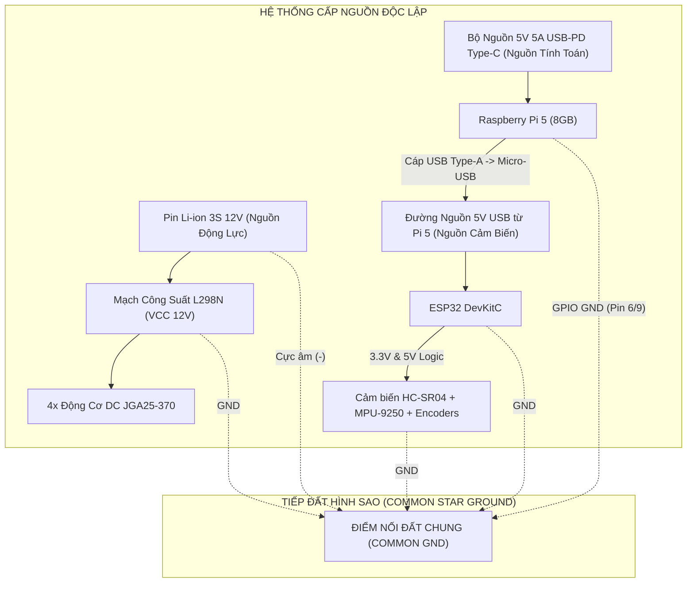
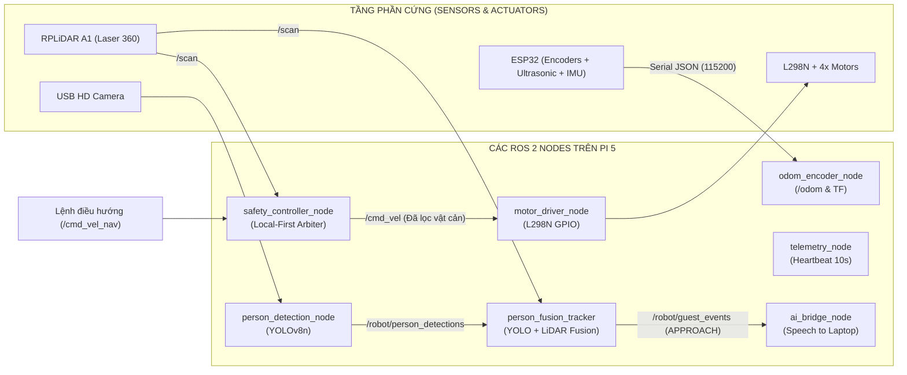

# ĐẶC TẢ KIẾN TRÚC PHẦN CỨNG & ROS 2 EDGE (HARDWARE & ROS 2 ARCHITECTURE)

> **Mục đích:** Tài liệu kỹ thuật chi tiết về toàn bộ hệ thống phần cứng, cơ khí, sơ đồ đấu dây, firmware vi điều khiển ESP32 và các ROS 2 nodes trên Raspberry Pi 5 của Robot HC-Robot.
> **Ngày rà soát & xác minh:** 06/11/2026.
> **Mức độ xác minh:** `[Đã đối chiếu code & sơ đồ phần cứng thực tế]`.
> **Tài liệu liên quan:**
> - Bản đồ source: [[01-File-Map|01-File-Map (Bản đồ source code)]]
> - Kiến trúc hệ thống: [[02-Architecture|02-Architecture (Kiến trúc tổng thể)]]
> - Mạng phân tán: [[distributed_ros2|Kiến Trúc Mạng ROS 2 Phân Tán]]
> - Cảm biến siêu âm: [[ultrasonic_setup|Cấu Hình Cảm Biến Siêu Âm HC-SR04 & ESP32]]

---

## 1. Thông Số Cơ Khí & Kích Thước Hình Học (Mechanical Specifications)

| Thông số | Giá trị đo đạc thực tế | Ghi chú thiết kế |
| :--- | :--- | :--- |
| **Chiều cao tổng thể** | **30 cm** | Tính từ mặt đất đến đỉnh tháp LiDAR RPLiDAR A1 |
| **Chiều dài thân xe** | **25 cm** | Chassis đa tầng bằng mica/nhôm định hình |
| **Chiều rộng thân xe** | **15 cm** | Bề ngang gọn gàng, tối ưu di chuyển qua khe hẹp tiền sảnh |
| **Bán kính bánh xe ($R$)** | **3.3 cm** (Đường kính 6.6 cm) | Bánh xe cao su bám đường, trục D-shaft gắn encoder |
| **Khoảng cách 2 bánh ($L$)** | **22 cm** (`wheel_base = 0.22m`) | Khoảng cách tâm giữa vệt lăn 2 cụm bánh dẫn động |
| **Kích thước các tầng** | **25.5 cm x 15 cm** | Cấu trúc 3 tầng xếp chồng |
| **Khoảng cách giữa các tầng**| **5 cm** | Khoảng thoáng tản nhiệt và đi dây điện tín hiệu |
| **Vị trí Camera** | **Cách tâm 13 cm** về phía trước | Camera góc rộng nhận diện người bằng YOLOv8 |
| **Vị trí LiDAR** | **Tọa độ tâm (0, 0)** | RPLiDAR A1 đặt tại tâm trục quay để quét 360° |

---

## 2. Kiến Trúc Phân Tách Nguồn & Tiếp Đất Chung (Power Architecture & Grounding)

Để triệt tiêu hiện tượng sụt áp (brownout) làm khởi động lại Raspberry Pi 5 và nhiễu sóng điện từ từ động cơ DC sang cảm biến nhạy cảm, hệ thống sử dụng **3 đường nguồn độc lập (Independent Power Rails)**:



### Nguyên tắc đấu nối bắt buộc:
1. **Nguồn 12V Động Cơ:** Cấp trực tiếp vào cọc 12V và GND của mạch L298N. Không lấy nguồn 5V của Pi nuôi động cơ.
2. **Nguồn Raspberry Pi 5:** Dùng nguồn Type-C công suất cao 5V 5A hỗ trợ chuẩn PD để Pi 5 chạy ổn định đầy tải khi xử lý YOLOv8 và SLAM.
3. **Tiếp Đất Sao (Common Star Ground):** Cực âm của Pin 12V, chân GND của L298N, chân GND của Raspberry Pi 5 và chân GND của ESP32 phải đấu chung vào 1 điểm để đồng nhất mức điện thế tham chiếu logic.

---

## 3. Sơ Đồ Đấu Dây Chi Tiết (Wiring & Pinout Assignment)

### 3.1. Kết Nối Giữa Raspberry Pi 5 và Mạch Động Cơ L298N (Điều Khiển Vận Tốc)
Tín hiệu lái động cơ được xuất trực tiếp từ GPIO của Raspberry Pi 5 (`hc_robot_client/nodes/motor_driver_node.py`):

| Chân Raspberry Pi 5 | Tên BCM GPIO | Kết nối L298N | Chức năng điều khiển |
| :--- | :--- | :--- | :--- |
| **Pin 11** | `GPIO 17` | `IN1` | Cụm bánh trái: Tiến (Left Forward) |
| **Pin 13** | `GPIO 27` | `IN2` | Cụm bánh trái: Lùi (Left Backward) |
| **Pin 15** | `GPIO 22` | `IN3` | Cụm bánh phải: Tiến (Right Forward) |
| **Pin 16** | `GPIO 23` | `IN4` | Cụm bánh phải: Lùi (Right Backward) |
| **Pin 6 / Pin 9** | `GND` | `GND` | Tiếp đất chung (Common Star Ground) |
| *Jumper ENA & ENB* | - | Nối chân 5V trên L298N | Giữ nguyên jumper để luôn kích hoạt cầu H ở tốc độ danh định |

### 3.2. Cổng Ngoại Vi Cắm Vào Raspberry Pi 5 (USB Hub)
- **USB 3.0 Cổng 1:** RPLiDAR A1/C1 (Quét laser 360°, baud 115200, tạo topic `/scan`).
- **USB 3.0 Cổng 2:** Camera HD (nhận diện khuôn mặt/người phục vụ `person_detection_node`).
- **USB 2.0 Cổng 3:** Kết nối bo mạch ESP32 DevKitC (vừa cấp nguồn 5V vừa truyền Serial 115200 baud).

---

### 3.3. Kết Nối Cảm Biến & Encoder Vào Bo Mạch ESP32 DevKitC

Tất cả cảm biến khoảng cách, la bàn/con quay hồi chuyển và encoder đo quãng đường được quản lý tập trung bởi ESP32 (`robot/esp32/main.py`):

#### A. 4x Cảm Biến Đo Quãng Đường Quadrature Encoders (JGA25-370)
- **Điện áp nuôi:** Chân VCC của cả 4 Encoder nối vào chân **3.3V** của ESP32 (để xuất xung vuông an toàn 3.3V, không gây cháy vi điều khiển).
- **Chỉ số xung:** `DEFAULT_ENCODER_CPR = 330.0` xung/vòng.

| Vị trí động cơ | Phase A (Kênh A) | Phase B (Kênh B) | Chiều quay mặc định |
| :--- | :--- | :--- | :--- |
| **Motor 1 (Trước - Trái)** | `GPIO 4` | `GPIO 5` | Thuận chiều |
| **Motor 2 (Sau - Trái)** | `GPIO 13` | `GPIO 14` | Thuận chiều |
| **Motor 3 (Trước - Phải)** | `GPIO 16` | `GPIO 17` | Đảo dấu (`encoder_m3_sign = -1.0`) |
| **Motor 4 (Sau - Phải)** | `GPIO 23` | `GPIO 27` | Đảo dấu |

#### B. 4x Cảm Biến Siêu Âm HC-SR04 (Tránh Va Chạm Điểm Mù)
- **Điện áp nuôi:** Nối VCC vào đường **5V**; GND nối đất chung.
- **Mạch bảo vệ chân Echo:** Tín hiệu Echo xuất 5V $\rightarrow$ bắt buộc đi qua mạch cầu phân áp điện trở ($R_1 = 1\text{k}\Omega$, $R_2 = 2\text{k}\Omega$) để hạ áp về $3.33\text{V}$ trước khi đưa vào GPIO của ESP32:

| Vị trí cảm biến | Chân Trigger (Phát xung) | Chân Echo (Thu xung qua cầu phân áp) | Ghi chú |
| :--- | :--- | :--- | :--- |
| **FRONT (Phía Trước)** | `GPIO 18` | `GPIO 34` | GPIO 34 là chân Input-Only |
| **REAR (Phía Sau)** | `GPIO 19` | `GPIO 35` | GPIO 35 là chân Input-Only |
| **LEFT (Bên Trái)** | `GPIO 21` | `GPIO 32` | Tránh va chạm sườn khi quay |
| **RIGHT (Bên Phải)** | `GPIO 22` | `GPIO 33` | Tránh va chạm sườn khi quay |

#### C. Cảm Biến Con Quay & Gia Tốc Kép IMU (MPU-9250 / MPU-6500)
- **Giao thức:** I2C Bus ID 0, tần số chuẩn 400 kHz (fallback 100 kHz).
- **Địa chỉ:** `0x68` (Chân `AD0` nối GND).
- **Điện áp:** Nối VCC vào **3.3V** (Tuyệt đối không cấp 5V).
- **Chân kết nối:**
  - `SDA` $\rightarrow$ `GPIO 25` của ESP32.
  - `SCL` $\rightarrow$ `GPIO 26` của ESP32.

---

## 4. Giao Thức Truyền Tin Serial Giữa ESP32 và Raspberry Pi 5

- **Tốc độ truyền:** `115200 baud`, 8-N-1 qua cổng kết nối USB-UART.
- **Định dạng dữ liệu:** Chuỗi JSON Lines (`\n` ở cuối mỗi gói tin), tần số phát 20 Hz.

### Cấu trúc gói tin Telemetry gửi lên Raspberry Pi 5:
```json
{
  "encoders": {
    "m1": {"ticks": 1240, "speed_rpm": 45.2},
    "m2": {"ticks": 1238, "speed_rpm": 45.0},
    "m3": {"ticks": -1242, "speed_rpm": -45.3},
    "m4": {"ticks": -1239, "speed_rpm": -45.1}
  },
  "ultrasonic": {
    "front": 85.4,
    "rear": 120.0,
    "left": 45.2,
    "right": 60.1
  },
  "imu": {
    "available": true,
    "accel": {"x": 0.01, "y": -0.02, "z": 0.99},
    "gyro": {"x": 0.1, "y": -0.2, "z": 1.5},
    "yaw_rate_dps": 1.5
  },
  "ts": 1730000000.123
}
```

---

## 5. Danh Mục Các ROS 2 Nodes Vận Hành Trên Raspberry Pi 5

Gói phần mềm `hc_robot_client` (ROS 2 Humble) chạy phân tán trên Raspberry Pi 5 gồm các node sau:



### 1. `odom_encoder_node.py` (Tính toán Odometry Vi sai)
- Lắng nghe số xung ticks từ ESP32 qua Serial.
- Tính toán vận tốc dài ($v_x$), vận tốc góc ($\omega$), tọa độ vị trí ($x, y, \theta$).
- Xuất bản topic `/odom` (`nav_msgs/msg/Odometry`) và broadcast TF frame `odom` $\rightarrow$ `base_footprint` ở tần số **20 Hz**.

### 2. `safety_controller_node.py` (Trọng Tài An Toàn Cục Bộ - Zero Latency)
- Chạy 100% nội tại trên CPU Pi 5, không phụ thuộc vào kết nối Wi-Fi hay Laptop.
- Lắng nghe lệnh vận tốc từ `/cmd_vel_nav` hoặc `/cmd_vel_in` và chùm tia laser từ `/scan`.
- Quét góc hình nón phía trước $70^\circ$ ($\pm 35^\circ$):
  - **Phanh khẩn cấp:** Cự ly $\le 0.50\text{ m}$ $\rightarrow$ lập tức ghìm `linear.x = 0`, `angular.z = 0`, xuất cảnh báo `EMERGENCY_STOP`.
  - **Giảm tốc:** Cự ly $\le 0.80\text{ m}$ $\rightarrow$ giảm 50% vận tốc, xuất cảnh báo `SLOWDOWN`.
  - **An toàn:** Cự ly $> 0.80\text{ m}$ $\rightarrow$ chuyển tiếp lệnh `/cmd_vel` tới `motor_driver_node`.

### 3. `motor_driver_node.py` (Chấp Hành Động Cơ)
- Đăng ký nhận `/cmd_vel` đã được thẩm định an toàn từ `safety_controller_node`.
- Ánh xạ vận tốc sang tín hiệu đóng ngắt GPIO BCM 17, 27, 22, 23 trên Pi 5.

### 4. `person_detection_node.py` & `person_fusion_tracker.py` (Thị Giác & Dung Hợp)
- Chạy mô hình YOLOv8n trên frame hình camera USB.
- Chiếu góc nhìn FOV của người lên chùm tia LiDAR `/scan` để tính cự ly mét thực tế.
- Máy trạng thái phát hiện khách: `FAR` $\rightarrow$ `APPROACHING` ($1.5\text{m} - 2.5\text{m}$) $\rightarrow$ `NEAR` ($0.8\text{m} - 1.5\text{m}$).
- Khi khách bước vào cự ly phục vụ, phát sự kiện `/robot/guest_events: GUEST_APPROACH` để Kiosk tự động mở mắt chào hỏi.

---

## 6. Mạng Phân Tán CycloneDDS Qua VPN Tailscale

Để Laptop (chạy AI Backend, Foxglove, RViz2) và Raspberry Pi 5 (chạy ROS 2 hardware nodes) nhìn thấy nhau trên cùng một ROS 2 Domain mà không bị ảnh hưởng bởi tường lửa khách sạn, hệ thống cấu hình CycloneDDS qua mạng Unicast VPN:

- **Laptop IP (Tailscale):** `100.99.72.51`
- **Raspberry Pi 5 IP (Tailscale):** `100.92.82.61`
- **Cấu hình DDS (`cyclonedds_pi.xml` & `cyclonedds_laptop.xml`):**
  - Tắt Multicast: `<AllowMulticast>false</AllowMulticast>`.
  - Khai báo Unicast Peers tĩnh trong thẻ `<Peers>`.
  - Thiết lập biến môi trường: `export CYCLONEDDS_URI=file:///path/to/cyclonedds_pi.xml` và `export RMW_IMPLEMENTATION=rmw_cyclonedds_cpp`.

