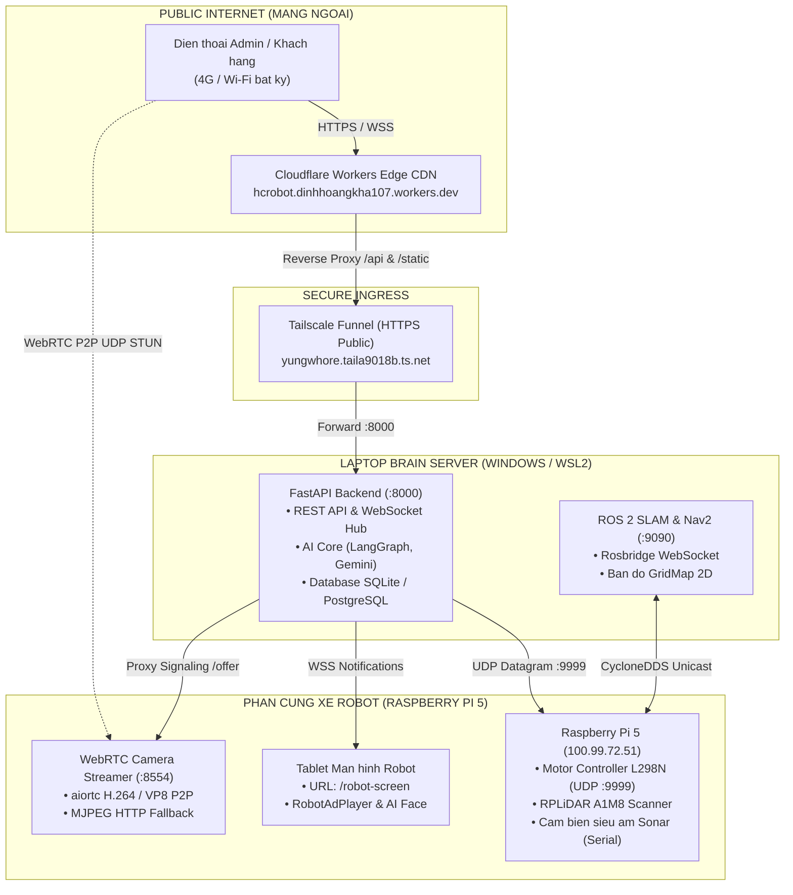
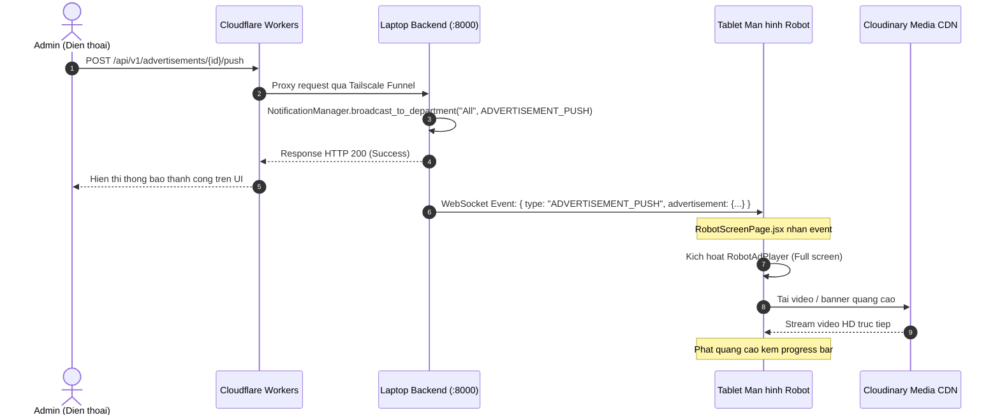

# Kien Truc Hybrid Cloud va Huong Dan Trien Khai Demo HC-Robot

Tai lieu dac ta kien truc Hybrid Cloud (Dam may lai) giua Cloudflare Workers, Laptop Brain Server va Raspberry Pi 5 tren Robot. Cung cap so do luong du lieu (Data Flow), co che truyen thong thoi gian thuc va quy trinh van hanh thuc te cho buoi Demo.

---

## 1. Tong Quan Kien Truc Hybrid Cloud

He thong HC-Robot ap dung mo hinh Hybrid ket hop giua Edge Computing, Private Mesh Network va Cloud CDN:



---

## 2. Ly Do Ap Dung Kien Truc Hybrid

| Tang kien truc | Vi tri van hanh | Nhiem vu cot loi | Ly do khong the dua het len Cloud |
| :--- | :--- | :--- | :--- |
| **Phan cung Robot** | Raspberry Pi 5 (tren xe) | Dieu khien dong co L298N, doc cam bien sieu am, quay RPLiDAR, doc Camera USB. | Cac thiet bi vat ly bat buoc phai co ket noi GPIO/USB truc tiep voi vi dieu khien. |
| **Bo nao tinh toan (Brain Server)** | Laptop (Core i7/i9, GPU) | Chay ROS 2 SLAM, Nav2 Costmap, AI Vision (MediaPipe), WebSocket Notification Hub, RAG Database. | Pi 5 bi gioi han ve RAM va CPU, khong du tai de chay dong thoi SLAM va mo hinh AI lon. |
| **Cong giao tiep (Public Edge)** | Cloudflare Workers | Phuc vu giao dien Web (Single Page App), dinh tuyen request nguoi dung toan cau. | Khong can mo port modem, khong can thue IP tinh, nguoi dung ben ngoai khong can cai dat gi. |

---

## 3. Luong Xu Ly Du Lieu Thuc Te (Data Flow)

### 3.1. Kich ban: Day Quang Cao tu Dien thoai xuong Man hinh Robot



### 3.2. Kich ban: Lai Xe Teleop tu xa va Dung Khan Cap (E-STOP)

1. Dien thoai bam nut tien/lui hoac can Joystick.
2. Trinh duyet gui `POST /api/v1/operations/robot/control` voi body `{ command: "w", speed: 75, target_ip: "100.99.72.51", port: 9999 }`.
3. Backend Laptop nhan request, tao UDP Socket ban thang goi tin `drive:75:75` toi IP `100.99.72.51:9999`.
4. Pi 5 nhan byte UDP trong vong **15 - 30ms**, truyen xung PWM toi mach L298N de quay banh xe.
5. Watchdog tren Pi 5 (`udp_command_watchdog.py`) tu dong ngat dong co neu mat ket noi qua 1.0 giay de dam bao an toan.

### 3.3. Kich ban: Xem Camera FPV khong do tre (WebRTC P2P)

1. Dien thoai khoi tao `RTCPeerConnection` va tao SDP Offer (`recvonly`).
2. Trinh duyet gui SDP Offer toi Backend qua POST `/api/v1/operations/robot/camera/webrtc-offer`.
3. Backend proxy request sang Pi 5: `http://100.99.72.51:8554/offer`.
4. `camera_stream.py` tren Pi 5 nhan Offer, tao Answer, va cho ICE Gathering hoan tat de dong goi du candidate (Tailscale IP, LAN IP, STUN public reflexive).
5. Pi 5 tra ve SDP Answer ve dien thoai.
6. Dien thoai nap Remote Description. Luong UDP P2P thiet lap truc tiep giua dien thoai va Pi 5. Video truyen toc do 15 - 30 fps voi do tre chi **50 - 100ms**.

---

## 4. Hai Che Do Van Hanh Khi Di Demo

### Che do 1: Hybrid Mode (Uu tien so 1 khi co Internet / 4G)

- **Dieu kien:** Co ket noi Internet (qua Wi-Fi phong thi hoac dien thoai phat 4G Hotspot).
- **Quy trinh khoi dong:**
  1. Bat Tailscale tren Laptop va Pi 5 (kiem tra bang `tailscale status`).
  2. Tren Laptop:
     ```bash
     tailscale funnel --bg 8000
     python -m uvicorn app.main:app --host 0.0.0.0 --port 8000
     ```
  3. Tren Pi 5:
     ```bash
     python3 ~/HCROBOT/robot/main.py --no-camera
     /home/phuc/HCROBOT/robot/.venv/bin/python ~/HCROBOT/robot/scripts/camera_stream.py --port 8554
     ```
  4. Tren Tablet nguc xe: Mo Chrome truy cap `https://hcrobot.dinhhoangkha107.workers.dev/robot-screen`.
  5. Tren Dien thoai Admin / Giam khao: Truy cap `https://hcrobot.dinhhoangkha107.workers.dev/admin`.

### Che do 2: 100% Local Offline Mode (Du phong su co mat mang)

- **Dieu kien:** Phong hoi truong bi pha song, khong co 4G, mat mang ngoai.
- **Quy trinh khoi dong:**
  1. Ket noi Laptop, Pi 5 va Tablet vao cung mot Router Wi-Fi cuc bo (khong can day Internet).
  2. Tren Laptop:
     - Chay Backend: `python -m uvicorn app.main:app --host 0.0.0.0 --port 8000`
     - Chay Frontend: `cd frontend && npm run dev -- --host 0.0.0.0 --port 3000`
  3. Xac dinh IP noi bo cua Laptop (vi du: `192.168.1.50`).
  4. Tren Tablet xe va Dien thoai: Mo trinh duyet truy cap truc tiep vao `http://192.168.1.50:3000`.
  5. Moi tinh nang dieu khien xe, ban do LiDAR, day quang cao van hoat dong 100% voi do tre cuc thap (< 5ms).

---

## 5. Xu Ly Su Co Thuong Gap Khi Demo (Troubleshooting)

| Hien tuong | Nguyen nhan | Huong khac phuc |
| :--- | :--- | :--- |
| **Camera bi den, "WebRTC Live" cham vang** | Chip USB camera bi freeze sut ap (Loi kernel `-EPROTO -71`). | Chay tren terminal Pi: `sudo usbreset 4c4a:4a55` hoac rut ra cam lai cong USB. |
| **Bao "Pi5 Offline" tren man hinh** | Request kiem tra suc khoe vuot qua timeout do mang yeu. | He thong da nang timeout len 8000ms. Kiem tra service port 8554 tren Pi. |
| **Loi chunk "Failed to fetch dynamically imported module"** | Trinh duyet luu cache ban build cu cua Cloudflare. | Bam nut "Tai lai trang (Khoi phuc mac dinh)" tren man hinh ErrorBoundary de tu xoa cache. |
| **Quang cao khong len video** | File video luu local bi chan boi Cloudflare. | Dung link Cloudinary CDN (he thong tu dong upload len Cloudinary khi tao quang cao). |
