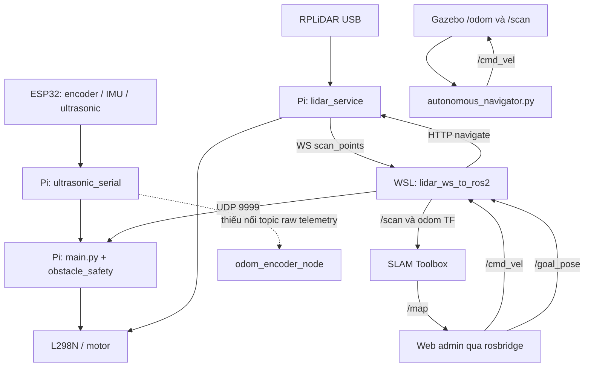

**Rà soát HCROBOT: robot, cảm biến, SLAM, navigation và mô phỏng**

Ngày kiểm tra: 24/10/2026. Workspace: `D:\do_an_fptu\HCROBOT`.

Đã chạy `git pull --ff-only origin development`, cập nhật từ `c2d6f86` lên `5e6197af9121b315ac1cff92ee5c46b494ccc280`. Các nhận xét dưới đây đã được đối chiếu với commit mới. Thư mục local `docs/hardware-evidence/` được giữ nguyên. Không chỉnh sửa mã nguồn vận hành trong lần rà soát này.

**Kết luận**

Repo có nhiều thành phần cần thiết cho một robot: điều khiển động cơ, siêu âm, encoder, IMU, camera, LiDAR, SLAM Toolbox, giao diện bản đồ và mô phỏng. Tuy nhiên, luồng chạy robot thật hiện chưa tạo thành một chuỗi định vị–lập đường–điều khiển thống nhất. Các vấn đề đáng ưu tiên nằm ở mất dữ liệu encoder, odometry suy từ lệnh, nhiều nguồn điều khiển motor, xử lý mất cảm biến và dừng khẩn cấp. Có cấu hình Nav2 trong repo, nhưng các launcher chính đang sử dụng bộ điều hướng tự viết.

Đây là kiểm tra mã nguồn, cấu hình và test offline. Chưa xác minh các service thực tế trên Pi/WSL, firmware đang nạp, chiều quay bánh, thông số encoder hoặc chất lượng SLAM khi chạy xe. Không chạy launcher, flash firmware hay gửi lệnh chuyển động tới robot. Các phép tái hiện có gọi đường điều khiển đã mock motor và chặn gửi UDP.

**Phạm vi và bản đồ thư mục**

Đã kiểm kê toàn repo, đọc sâu các luồng robot và các điểm nối backend/frontend. Có 124 file được Git quản lý trong `robot/`, 173 file trong SDK LiDAR, 190 file backend, 155 file frontend và 11 file tài liệu được Git quản lý. Dependencies, cache, dữ liệu Chroma và phần nghiệp vụ khách sạn không liên quan chuyển động không được coi là phạm vi review sâu. SDK bên thứ ba được kiểm tra vai trò/tích hợp, không audit từng dòng C++.

| Thành phần | File/thư mục chính | Vai trò thực tế trong mã |
| --- | --- | --- |
| Chương trình robot thật | `robot/main.py`, `motor_controller.py`, `settings.yaml` | Pi điều khiển 2 kênh L298N; bàn phím/UDP; khởi động camera và LiDAR service |
| Siêu âm và dữ liệu ESP32 | `robot/obstacle_safety.py`, `ultrasonic_serial.py` | Parse JSON serial, ngưỡng chặn theo hướng, timeout dữ liệu, hysteresis |
| Firmware | `robot/esp32/` | MicroPython đọc 4 encoder, 4 siêu âm và MPU; có thêm bản Arduino khác pinout |
| LiDAR/navigation trên Pi | `robot/scripts/lidar_service.py` | Đọc gói serial, raytracing occupancy grid, REST/WS, teleop, reactive navigation, frontier, workflow |
| SLAM trên WSL | `robot/ros2_configs/start_wsl_slam.sh`, `lidar_ws_to_ros2.py`, `slam_toolbox_params.yaml` | Chuyển WS thành `/scan`, phát odom/TF, chạy SLAM Toolbox và rosbridge |
| Gói ROS 2 | `robot/src/hc_robot_client/` | Các node motor, odom encoder, safety, perception/fusion, AI và telemetry |
| Nav2 | `robot/ros2_configs/nav2/` | AMCL, DWB, Navfn, costmap, lifecycle, twist mux; launcher phụ thuộc package ngoài repo |
| Mô phỏng | `robot/models/`, `worlds/`, `description/`, `scripts/autonomous_navigator.py` | Gazebo Harmonic, DiffDrive, LiDAR/camera; waypoint cho sa bàn khách sạn |
| Backend bản đồ/điều khiển | `backend/app/api/v1/endpoints/map.py`, `operations/robot_control.py`, `services/hardware/rplidar_service.py` | Kho bản đồ/waypoint/zone, UDP control, nhánh LiDAR COM9 riêng |
| Web admin | `frontend/src/pages/admin/AdminLidarPage.jsx`, `components/admin/`, `services/rosbridgeService.js` | Hiển thị ROS map/scan/odom, teleop, goal, lưu/khóa map, E-stop |
| Kiosk/workflow | `frontend/src/hooks/useWorkflowRunner.js`, `components/robot/`, `pages/admin/tabs/workflow/` | Giao diện khách, bản đồ tầng, workflow và mô phỏng; không phải tất cả đều là navigation robot thật |
| SDK LiDAR | `rplidar_sdk_master/` | SDK C++ và chương trình mẫu; luồng Python chính tự parse serial, không tìm thấy liên kết sử dụng SDK này trong các runtime Python/launcher đã rà |
| Dữ liệu bản đồ | `robot/maps/`, `backend/static/maps/` | JSON, YAML, PGM; metadata JSON hiện có kích thước 108×147, resolution 0.05 m |
| Script ngoài root | `start_all*.bat`, `demo_tu_hanh.bat`, `open_*.bat`, `scan_and_save_map.py`, `test_lidar.py` | Launcher Windows/WSL và công cụ đọc LiDAR trực tiếp trên Windows |

`robot.zip` mới được pull có 221 entry. Nội dung bridge, LiDAR service và SLAM YAML trong zip khác file đang checkout; cần xác định rõ nguồn triển khai, tránh dùng nhầm một snapshot cũ.

**Ba luồng chạy đang tồn tại**

1. **Robot thật:** `main.py` chạy GPIO, serial ESP32, HTTP camera 8554, HTTP/WS LiDAR 8000, UDP control 9999. Motor nằm trên Pi; MicroPython mặc định tắt motor output ESP32.
2. **SLAM:** `start_all.bat` gọi `start_wsl_slam.sh`, chạy robot_state_publisher, rosbridge 9090, bridge LiDAR và SLAM Toolbox. Cấu hình hiện tại là mapping, lưới 5 cm, lọc laser dưới 20 cm, ngưỡng dịch chuyển 0.30 m / quay 0.45 rad. Việc chỉnh các ngưỡng này chưa chứng minh bản đồ ngoài thực tế ổn định.
3. **Gazebo:** `launch_gazebo.sh` và `launch_autonomous_demo.sh` chạy world, ros_gz_bridge, rosbridge và `autonomous_navigator.py`. Bộ điều hướng này dùng odom mô phỏng, né LiDAR và waypoint viết cho sa bàn 10×6 m. Launcher không chạy Nav2; nó cũng không khởi động SLAM Toolbox trong luồng demo này.

Occupancy grid tự raytrace trên Pi và grid từ SLAM Toolbox là hai bản đồ khác nhau. Backend COM9 còn có một grid riêng. Tên hàm/UI chứa chữ SLAM hoặc NAV2 không đủ để xác nhận chúng đang sử dụng cùng bộ định vị và điều hướng.

**Các lỗi và thiếu sót cần ưu tiên**

P1: ảnh hưởng trực tiếp đến chuyển động, dữ liệu định vị hoặc chức năng chính. P2: cấu hình/tích hợp/hiển thị cần sửa để hệ thống tái lập và vận hành nhất quán. Các mức này không phải chứng nhận an toàn phần cứng.

| Mức | Phát hiện và bằng chứng | Hệ quả / hướng xử lý |
| --- | --- | --- |
| P1 | **UDP receiver chính thiếu timeout lệnh.** [main.py:55](D:/do_an_fptu/HCROBOT/robot/main.py:55) chỉ bỏ qua socket timeout; bridge [lidar_ws_to_ros2.py:357](D:/do_an_fptu/HCROBOT/robot/ros2_configs/lidar_ws_to_ros2.py:357) chỉ gửi khi đổi hướng. | Khi WSL chết hoặc mất gói STOP, Pi có thể giữ lệnh chạy nếu cảm biến vẫn cho phép. Cần heartbeat + command timeout tại Pi, đồng thời sửa sender gửi định kỳ. Timeout trong `motor_controller.run_udp_server_controller` không áp dụng cho listener của `main.py`. |
| P1 | **Thiếu ESP32 tự chuyển sang bỏ safety; thiếu LiDAR được hiểu là khoảng trống.** [main.py:504](D:/do_an_fptu/HCROBOT/robot/main.py:504), [main.py:560](D:/do_an_fptu/HCROBOT/robot/main.py:560), [lidar_service.py:606](D:/do_an_fptu/HCROBOT/robot/scripts/lidar_service.py:606). | Đã tái hiện: không có scan, khoảng cách trả 99 m, lệnh forward gọi motor mock. Cần phân biệt CLEAR / UNKNOWN / STALE; mất cảm biến phải đi vào trạng thái dừng của chế độ vận hành bình thường. |
| P1 | **Motor có nhiều đường gọi, safety không tập trung.** [main.py:425](D:/do_an_fptu/HCROBOT/robot/main.py:425) chia sẻ motor cho LiDAR core; [lidar_service.py:733](D:/do_an_fptu/HCROBOT/robot/scripts/lidar_service.py:733) tác động trực tiếp GPIO trước khi gửi UDP qua safety. | Lệnh HTTP có thể tác động trước kiểm tra ultrasonic. Ngược lại, lệnh UDP/bàn phím không cập nhật `current_motion_cmd` của LiDAR watchdog. Cần một nơi duy nhất cấp lệnh motor và tổng hợp mọi interlock. |
| P1 | **E-stop chưa hủy mọi nguồn phát lệnh.** [AdminLidarPage.jsx:699](D:/do_an_fptu/HCROBOT/frontend/src/pages/admin/AdminLidarPage.jsx:699) không clear interval teleop; [lidar_service.py:1655](D:/do_an_fptu/HCROBOT/robot/scripts/lidar_service.py:1655) không gọi `stop_workflow()` và không có latch chặn lệnh mới. | Nếu interval đang chạy, lệnh tiến có thể được phát lại sau STOP. Mock xác nhận workflow vẫn active sau E-stop. Cần hủy timer/job, chặn phát lệnh và có thao tác reset rõ ràng. Trong demo, [autonomous_navigator.py:523](D:/do_an_fptu/HCROBOT/robot/scripts/autonomous_navigator.py:523) còn tự tiến khỏi NO_STOP khi ở STANDBY; không dùng logic này làm E-stop. |
| P1 | **Encoder bị đứt ở nhiều tầng.** [ultrasonic_serial.py:224](D:/do_an_fptu/HCROBOT/robot/ultrasonic_serial.py:224) copy snapshot nhưng bỏ `encoders`; [lidar_service.py:1808](D:/do_an_fptu/HCROBOT/robot/scripts/lidar_service.py:1808) gọi `get_snapshot()` không tồn tại. [odom_encoder_node.py:78](D:/do_an_fptu/HCROBOT/robot/src/hc_robot_client/hc_robot_client/nodes/odom_encoder_node.py:78) subscribe `/robot/raw_esp32_telemetry`, chưa thấy publisher trong repo. | Dù ESP32 đã gửi ticks, dữ liệu không đi hết tới UI/odometry. Mock xác nhận `_snapshot.encoders` có dữ liệu nhưng `latest().encoders` là `None`. Cần sửa API snapshot, giữ encoder khi copy và nối serial telemetry vào node odom. |
| P1 | **Odometry và điều hướng đang suy vị trí từ lệnh.** [bridge:365](D:/do_an_fptu/HCROBOT/robot/ros2_configs/lidar_ws_to_ros2.py:365) tích phân `current_vx/current_wz`; [LiDAR navigation:857](D:/do_an_fptu/HCROBOT/robot/scripts/lidar_service.py:857) dùng tốc độ/góc giả định. WS bridge bản mới bỏ qua `robot_pose` từ Pi. | Xe kẹt, trượt hoặc bị safety chặn vẫn có thể thay đổi vị trí tính toán. Bộ tự hành có thể báo tới đích sai. Cần odometry đo bằng encoder, xử lý IMU hợp lệ và dùng pose trong đúng frame cho navigation. Chỉnh scan matcher không giải quyết được nguồn odom này. |
| P1 | **Frame map và odom chưa được chuyển đổi đúng ở UI/goal.** [AdminLidarPage.jsx:262](D:/do_an_fptu/HCROBOT/frontend/src/pages/admin/AdminLidarPage.jsx:262) lấy trực tiếp `/odom` vẽ lên `/map`; [bridge:176](D:/do_an_fptu/HCROBOT/robot/ros2_configs/lidar_ws_to_ros2.py:176) chuyển thẳng goal sang Pi, không áp TF. | Khi SLAM hiệu chỉnh `map → odom`, robot hiển thị lệch map và tọa độ goal không còn tương đương tọa độ nội bộ Pi. Cần transform pose/goal hoặc một navigation stack sở hữu toàn bộ chuỗi TF. |
| P1 | **Scan cũ được phát lại với timestamp mới.** [lidar_service.py:1793](D:/do_an_fptu/HCROBOT/robot/scripts/lidar_service.py:1793) gửi cache scan định kỳ; [bridge:453](D:/do_an_fptu/HCROBOT/robot/ros2_configs/lidar_ws_to_ros2.py:453) gán thời gian nhận hiện tại, không kiểm tra scan ID/tuổi dữ liệu. | Khi sensor đứng hoặc mạng trễ, scan cũ có thể được gắn với pose mới. Cần timestamp/sequence ở lúc thu scan, bỏ bản trùng và chặn scan stale. Đồng thời sửa `angle_max` cho 360 bins: tia cuối ở 359°, không phải 360°. |
| P1 | **Nhánh Nav2 chưa tự tái lập từ repo.** [navigation_launch.py:15](D:/do_an_fptu/HCROBOT/robot/ros2_configs/nav2/navigation_launch.py:15), `launch_sim.launch.py`, `rsp.launch.py` tìm package `articubot_one`; repo chỉ có package `hc_robot_client`. Một số config được tham chiếu như `gz_bridge.yaml` không có trong repo. | Launcher chính không start Nav2/AMCL; goal hiện đi tới bộ điều hướng Pi tự viết. `nav2_params.yaml` còn dùng `/diff_cont/odom` trong khi stack chính phát `/odom`. Cần chọn luồng chuẩn, đóng gói launch/config/dependencies và nối đầy đủ localization, planner, controller, lifecycle. Package bên ngoài có thể tồn tại trên máy khác nhưng chưa được xác minh. |
| P1 | **Workflow navigation kiểm tra nhầm cờ.** [lidar_service.py:1024](D:/do_an_fptu/HCROBOT/robot/scripts/lidar_service.py:1024) thoát nếu `is_exploring=False`; workflow chỉ đặt `is_workflow_running=True` rồi gọi cùng hàm. | Mock xác nhận step navigate trả `False` ngay, vị trí không đổi. Workflow sau đó vẫn tiếp tục và có thể báo COMPLETED. Cần cancellation token theo job và trạng thái thất bại rõ ràng. |
| P1, nếu dùng bản Arduino | **Firmware Arduino trùng chân và khác sơ đồ MicroPython.** [arduino_firmware.ino:23](D:/do_an_fptu/HCROBOT/robot/esp32/arduino_firmware/arduino_firmware.ino:23) dùng GPIO34/35/32/33 cho echo; encoder cũng dùng các chân đó; GPIO27/14 trùng motor và encoder. | Không thể coi hai firmware là lựa chọn thay thế tương đương. MicroPython `main.py` phù hợp vai trò sensor hub hơn với tài liệu hiện tại. Cần chọn firmware triển khai và loại bỏ hoặc sửa cấu hình trùng pin của nhánh còn lại. Chưa xác minh firmware đang nạp trên board. |
| P1, nếu dùng API backend này | **Backend trả thành công khi lệnh không được chuyển tới robot.** [map.py:653](D:/do_an_fptu/HCROBOT/backend/app/api/v1/endpoints/map.py:653) và teleop catch lỗi nhưng trả SUCCESS; [map.py:698](D:/do_an_fptu/HCROBOT/backend/app/api/v1/endpoints/map.py:698) chỉ gán pose bằng goal. | UI/client dùng endpoint này có thể thấy robot “đã di chuyển” mà không có điều khiển thật. Cần trả lỗi kết nối, tách ACK khỏi hoàn tất goal, chỉ cập nhật pose từ telemetry. |
| P2 | **Lưu map dùng đường dẫn của máy cũ và nhiều nguồn map.** [bridge:147](D:/do_an_fptu/HCROBOT/robot/ros2_configs/lidar_ws_to_ros2.py:147) cố định `/mnt/f/DoAn/HC-Robot/robot/maps`; workspace hiện tại ở ổ D. [AdminLidarPage.jsx:465](D:/do_an_fptu/HCROBOT/frontend/src/pages/admin/AdminLidarPage.jsx:465) lưu ROS và Pi riêng rồi download từ backend. | Có thể tải map khác map đang hiển thị, thiếu file hoặc lưu sai nơi. Cần một nguồn map chuẩn và xác nhận kết quả save trước download. `load_map` của Pi chỉ nạp JSON vào grid Pi, chưa khôi phục trạng thái SLAM Toolbox/localization. |
| P2 | **Thông số cơ khí và điều khiển không thống nhất.** [robot.urdf:46](D:/do_an_fptu/HCROBOT/robot/description/robot.urdf:46) dùng chassis 33.5×26.5 cm; model/bridge dùng radius 3.3 cm, separation 29.7 cm; node encoder dùng track 22 cm. Ghi chú local `robot_size.txt` ghi 25×15 cm và radius 7 cm. Hai settings còn khác `invert_left_direction`. | Cần đo lại radius/diameter, khoảng cách tâm bánh, CPR theo cách đếm xung và vị trí sensor. Ghi chú “khoảng cách 2 bánh 5 cm” chưa rõ cách đo nên không dùng ngay làm track width. Nếu nối node encoder vào TF hiện tại, phải xử lý việc `base_footprint` đã là child của `base_link` trong URDF. |
| P2 | **CLI auto-map gọi route không tồn tại.** [auto_explore_and_map.py:24](D:/do_an_fptu/HCROBOT/robot/scripts/auto_explore_and_map.py:24) kiểm tra và poll `/api/v1/map/status`; service có `/lidar_status` và `/explore/status`. | CLI báo không kết nối dù service có thể đang chạy. Đã xác nhận từ route list thực tế của app trong process offline. |
| P2 | **Khóa map báo trạng thái trước khi có xác nhận; RViz web restart SLAM.** [bridge:162](D:/do_an_fptu/HCROBOT/robot/ros2_configs/lidar_ws_to_ros2.py:162) toggle local ngay sau `call_async`, không đọc kết quả; UI cũng toggle ngay. [start_wsl_rviz_web.sh:10](D:/do_an_fptu/HCROBOT/robot/ros2_configs/start_wsl_rviz_web.sh:10) kill SLAM/bridge trước bước “kiểm tra đang chạy”. | UI có thể báo khóa không đúng; mở viewer có thể làm mất phiên mapping chưa lưu. Cần ACK trạng thái thật và tách vòng đời viewer khỏi SLAM. |
| P2 | **Thiếu dependencies và setup chưa thống nhất.** `robot/requirements.txt` chưa khai báo FastAPI/uvicorn/websockets cho các service tương ứng; package ROS thiếu khai báo `nav_msgs`/`tf2_ros`; installer dùng Humble trong khi launcher chính source Jazzy. | Máy đang cài sẵn có thể chạy, nhưng cài từ repo sạch chưa bảo đảm. Cần manifest riêng theo Pi/WSL và một bộ hướng dẫn triển khai thống nhất. `run.sh` cũng không có fallback Jazzy khi `ROS_DISTRO` chưa được đặt. |
| P2 | **Canvas làm sai origin bằng 0.** [LidarCanvas.jsx:167](D:/do_an_fptu/HCROBOT/frontend/src/components/admin/LidarCanvas.jsx:167) dùng `origin_x || -5.0` và tương tự cho Y. | Map có origin 0 bị dịch thành -5 m. Dùng giá trị mặc định chỉ khi null/undefined. Các map lưu hiện tại có origin âm nên chưa kích hoạt trường hợp này. |

Ngoài ra, `send_udp_motor_command('speed:45')` đặt `current_motion_cmd` thành chuỗi speed và gọi `pi_motor.stop()` ở nhánh direct trước khi UDP cập nhật tốc độ. Đã tái hiện bằng mock. Nên tách lệnh tốc độ khỏi trạng thái hướng để watchdog không mất thông tin chuyển động. Node ROS safety cũng trả `SAFE` khi không có scan, không có kiểm tra tuổi scan; timer hiện chỉ publish trạng thái chứ không phát STOP định kỳ.

**Kết quả kiểm tra**

| Kiểm tra | Kết quả ở commit mới |
| --- | --- |
| `robot/tests` | 65 passed; chặn `socket.socket.sendto` để test không phát UDP ra mạng |
| `robot/src/hc_robot_client/tests` | 14 passed |
| `backend/tests/test_rplidar_service.py` | 3 passed; có cảnh báo `datetime.utcnow()` deprecated |
| `frontend`: `npm test -- --reporter=dot` | 61 passed trong 5 file |
| Parse Python trong robot | 55 file, không lỗi cú pháp |
| Parse YAML trong robot | 7 file, không lỗi cú pháp |
| Parse XML/Xacro/URDF/SDF/world/model config | 24 file, không lỗi XML |
| `bash -n` | 18 shell script, không lỗi cú pháp; chuẩn hóa CRLF trong bộ nhớ, không thực thi script |
| Map JSON | 3 file đọc được; mỗi file 15,876 ô, đúng 108×147 |

Tổng cộng 143 test được chọn đã pass. Đây không phải toàn bộ backend test suite. Test map endpoint cần database thật và có ghi/xóa bản đồ nên không chạy trong lần audit này. Không build firmware, không launch ROS/Gazebo và không kiểm tra chuyển động thật. Test odom hiện chủ yếu kiểm tra công thức được viết lại trong test, chưa kiểm tra node nhận telemetry tới TF. CI hiện không có job robot riêng; backend job còn `continue-on-error: true`.

**Thứ tự xử lý đề xuất**

1. Hợp nhất đường cấp lệnh motor; bổ sung command watchdog tại Pi; chặn vận hành khi sensor stale; hoàn thiện E-stop có latch và hủy nguồn lệnh.
2. Nối lại encoder/IMU từ ESP32 tới odometry; hiệu chuẩn kích thước và CPR; xác định một nguồn phát TF cho mỗi quan hệ frame.
3. Giữ timestamp/sequence scan; dùng pose đúng hệ tọa độ; xác minh mapping bằng dữ liệu đo trước khi tiếp tục chỉnh SLAM parameters.
4. Hoàn thiện một launch cho robot thật và một launch mô phỏng; chọn Nav2 hoặc bộ tự viết làm bộ điều hướng chính, tránh hai nguồn cùng phát vận tốc/TF.
5. Thống nhất nguồn bản đồ, luồng save/load, ACK goal và trạng thái UI; sửa workflow và CLI.
6. Bổ sung test tích hợp vào CI cho mất lệnh, mất scan, E-stop, encoder snapshot, frame transform và round-trip save/load map.

Những mục này là đề xuất sau audit; chưa được triển khai trong mã nguồn.
