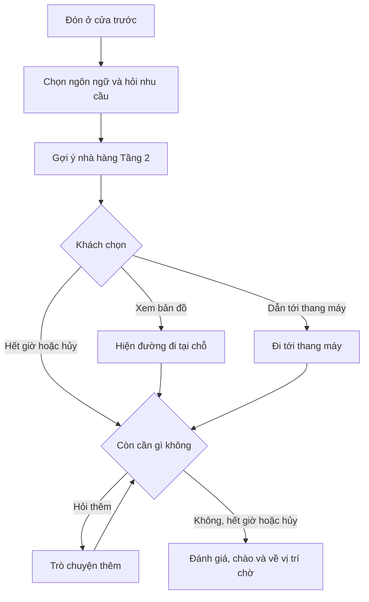

# Bàn giao bản đồ sảnh và kịch bản phục vụ khách

Ngày 06/11/2026 · Nhánh `lobby-map-doors` · Commit bản đồ `2694dad` · Đích di chuyển `5db5332` · Rẽ nhánh `f5865fb` · Demo ăn tối `b171848`

Web và Gazebo đã dùng chung mặt bằng sảnh có cửa trước và cửa sau. Các đích di chuyển cũ đã được chuyển sang waypoint hiện tại. Workflow đã có bước chờ khách chọn và rẽ nhánh, và kịch bản khách hỏi chỗ ăn tối đã có trong danh sách. **Việc tiếp theo là chạy thử demo trên UI cùng Gazebo, sau đó làm luồng yêu cầu dịch vụ.**

## Đã hoàn thành

| Hạng mục | Kết quả |
|---|---|
| Giao diện đã làm ở các nhánh trước | Robot Control có một không gian chung cho Control & SLAM và Live Camera, dùng chung bảng điều khiển. Room Service, Reception và Maintenance dùng khung giao diện theo Admin, có sidebar thu gọn và Settings đổi Anh–Việt. Tiếng Anh là mặc định. Room Service đã bỏ mục Housekeeping riêng, khối Low Stock và hai subtab dư. |
| Bản đồ web trên nhánh hiện tại | Đã dùng đúng ảnh mặt bằng người dùng cung cấp cho sảnh tầng trệt. Trong Workflow Studio, ảnh nền, vị trí robot, đường đi, waypoint và vùng điều khiển dùng cùng hệ tọa độ. Đã đối chiếu ảnh do web trả về với file gốc. |
| Sa bàn Gazebo | Sảnh rộng 19,60 × 12,60 m. Cửa trước ở giữa tường trái tại `(0.00, 6.25)`. Cửa sau ở tường phải, giữa lối thoát hiểm và WC, tại `(19.60, 3.53)`. Đã mở khoảng trống trên tường và hình va chạm. Điểm robot đứng đón khách nằm phía trong cửa trước tại `(0.90, 6.25)`. |
| Đích di chuyển | Workflow mẫu lấy đích từ `LOBBY_WAYPOINTS` trong backend. Bảng này khớp với waypoint trên web và trong bộ điều hướng ROS. Khi danh sách workflow được tải lần đầu, backend chuyển các bản đã lưu còn giữ đúng tọa độ mẫu cũ, hoặc điểm `(0, 0)`, sang waypoint hiện tại. Bước người dùng đã chỉnh đích được giữ nguyên. Hàm `resolveMoveTarget` trên web áp dụng cùng quy tắc. |
| Rẽ nhánh | Loại bước mới `CHOICE` hiện các nút lựa chọn, nghe khách nói từ khóa và chuyển tới bước của lựa chọn đó. Bước này có đích riêng khi hết giờ và khi khách hủy. Mọi bước có thể đặt `next_step_id` để các nhánh nhập lại. Studio và màn hình robot cùng dùng `resolveNextStepIndex` để chọn bước kế tiếp và cùng hiển thị `KioskChoicePrompt`. Workflow không dùng các trường này vẫn chạy tuần tự như trước. Trình soạn workflow đã chỉnh được lựa chọn và bước kế tiếp. |
| Gửi kịch bản tới màn hình robot | Màn hình robot nay nhận lệnh `WORKFLOW_DISPATCH` khi bấm nút "Phát kịch bản xuống Robot" trong Studio. Màn hình robot cũng đọc lời thuyết minh của bước SHOW và lời phát khi di chuyển của bước MOVE, giống Studio. |
| Kiểm tra đã chạy | Frontend build thành công. Test backend trong `tests/test_workflows_lobby.py` và test frontend về đích di chuyển, rẽ nhánh và khung lựa chọn đều qua. Bộ quyết định trên web đã đi đúng các nhánh của WF09 lấy từ API đang chạy. Gazebo đã nạp đúng hai cửa, và web cùng bộ điều hướng ROS tính ra cùng tuyến giữa hai cửa. **Chưa chạy thử trên UI.** |

## Kết quả đối chiếu kịch bản

Tài liệu đăng ký đề tài *Intelligent Hotel Concierge Robot*, mục 3.1, yêu cầu khách có thể chọn ngôn ngữ, hỏi và nhận tư vấn, gửi yêu cầu, theo dõi tiến độ, nhờ nhân viên và đánh giá sau tương tác. Vì vậy, tiêu chí của demo là **khách nhận được kết quả và nhân viên thấy đúng yêu cầu**. Số bước chỉ giúp ước lượng độ dài của kịch bản.

Sau khi nâng cấp, API `GET /api/v1/workflows` trả về **11 workflow, tổng cộng 59 bước**. Chỉ WF06 đang bật. Các tọa độ dưới đây tính bằng mét, theo thứ tự `(x, y)`.

| Workflow | Bước | Trạng thái |
|---|---:|---|
| WF01 · Đón khách | 5 | Bản đã lưu đã chuyển từ `(5.20, 1.00)` sang điểm đón `(0.90, 6.25)`. |
| WF02 · Tư vấn tiện ích | 5 | Không đổi. Phần gợi ý nhà hàng được dùng lại trong WF09. |
| WF03 · Dọn phòng hoặc gọi taxi | 5 | Chưa sửa. Bước tạo phiếu vẫn cố định phòng `304`, loại `HOUSEKEEPING` và bộ phận Housekeeping. |
| WF04 · Gặp lễ tân | 4 | Đã chuyển tới điểm trước quầy `(11.44, 2.80)`. |
| WF05 · Đánh giá và về trạm | 4 | Bước về trạm đã chuyển sang `ROBOT_STANDBY` tại `(7.20, 9.60)`. |
| WF06 · Tuần tra và quảng cáo | 2 | Đã chuyển tới tâm sảnh `(8.40, 6.40)`. |
| WF07 · Dẫn tới thang máy | 5 | Đã chuyển tới thang máy `(15.60, 6.96)`. Bước về trạm đã chuyển như WF05. |
| WF08 · Báo thức | 5 | Chưa sửa. Số phòng vẫn cố định là `304`. |
| WF09 · Khách hỏi chỗ ăn tối | 15 | Mới, đang tắt. Có hai bước `CHOICE`. |
| Đón Khách & Hướng Dẫn Dịch Vụ Sảnh Chính | 8 | Bước đầu từng trỏ tới `(0, 0)` với waypoint `wp-reception` đã bị xóa. Bước này đã chuyển tới điểm trước quầy lễ tân `(11.44, 2.80)`, vì tên đích đã lưu là "Quầy Lễ Tân". |
| Kịch bản phục vụ khách mới | 1 | Không đổi. Hiện chỉ có bước chào. |

Trong Studio, bước `MOVE` gửi đích tới Gazebo khi kết nối ROS và chỉ qua bước khi Gazebo báo tới đích. Trên màn hình robot, bước `MOVE` vẫn qua bước theo bộ đếm thời gian. Các bước `CREATE_REQUEST` và `FEEDBACK` ở cả hai nơi vẫn chuyển tiếp bằng bộ đếm thời gian. Muốn xác nhận nghiệp vụ, cần nhìn thấy phiếu hoặc đánh giá đã lưu ở màn hình tương ứng.

## Luồng demo WF09

WF09 ghép WF01, WF02, WF07 và WF05. Khi khách không chọn trong 30 giây hoặc bấm Hủy ở bước chọn đường, robot chuyển sang bước hỏi khách còn cần gì. Robot chỉ về vị trí chờ một lần, ở bước cuối.

## Thứ tự làm tiếp

1. **Chạy thử WF09 trên UI cùng Gazebo.** Làm theo mục nghiệm thu bên dưới. Ghi lại những chỗ thời gian chờ hoặc từ khóa giọng nói chưa hợp lý.
2. **Làm luồng yêu cầu dịch vụ từ WF03 và WF08.** Thu loại dịch vụ, số phòng và thông tin riêng như giờ báo thức hoặc điểm đón taxi. Cho khách xác nhận bằng bước `CHOICE`, tạo một phiếu qua API nghiệp vụ, chuyển đúng bộ phận và cho khách tra lại trạng thái sau khi nhân viên cập nhật. Lưu ý rằng luồng đặt taxi trên màn hình robot, khi khách chưa có phiên phòng, gọi `setPinModalNote` nhưng hàm này chưa được khai báo trong `RobotScreenPage.jsx`.
3. **Làm luồng gặp nhân viên từ WF01 + WF04 + WF05.** Khi khách yêu cầu hỗ trợ, xác nhận nhu cầu, chuyển nội dung cho lễ tân và chờ nhân viên tiếp nhận. Dùng phần kết thúc chung để khách đánh giá sau khi được hỗ trợ.
4. **Hoàn thiện chế độ rảnh WF06.** Cho phép tạm dừng quảng cáo khi bắt đầu phục vụ khách và tiếp tục sau khi phiên kết thúc.
5. **Cho bước MOVE trên màn hình robot chờ tới đích.** Màn hình robot chưa nhận tín hiệu tới đích, nên nhánh dẫn đường ở đó chỉ chờ theo thời gian.
6. **Dọn waypoint trong DB.** Bảng waypoint hiện chỉ có ba điểm thử nghiệm: hai điểm "Điểm Mốc #1" và một điểm "Trạm Sạc #2". Studio thay danh sách waypoint chuẩn bằng ba điểm này khi DB có dữ liệu. Backend cũng ghi chúng vào marker Gazebo theo thứ tự, không theo loại điểm.

## Cách nghiệm thu trên UI

Mở Gazebo bằng [open_gazebo.bat](../../open_gazebo.bat). Khi backend và frontend đã chạy, vào **Admin → Robot Control → Workflow Step Management → Giả lập**. Thực hiện các kiểm tra dưới đây trực tiếp trên UI.

- **Bản đồ và đích di chuyển:** So sánh hai cửa trên web và trong Gazebo. Chạy WF01 để kiểm tra robot dừng phía trong cửa trước. Chạy WF04 và WF07, quan sát robot dừng trước quầy lễ tân hoặc trước thang máy, rồi kiểm tra hành trình về vị trí chờ.
- **Rẽ nhánh với WF09:** Chọn Workflow 9 và chạy. Ở bước 7, khung lựa chọn hiện trên sa bàn. Lượt đầu chọn **Xem bản đồ** và kiểm tra robot đứng yên ở cửa trước. Lượt sau chọn **Dẫn tới thang máy** và kiểm tra bước 10 chỉ bắt đầu khi Gazebo báo tới đích. Lượt thứ ba bấm **Hủy** hoặc để hết giờ, rồi kiểm tra robot sang bước hỏi thêm. Ở mọi lượt, robot chỉ về vị trí chờ một lần.
- **Trên màn hình robot:** Mở màn hình robot, rồi bấm "Phát kịch bản xuống Robot" trong Studio khi đang chọn WF09. Màn hình robot cần hiện cùng khung lựa chọn và nhận cả chạm lẫn giọng nói.
- **Sau khi nối nghiệp vụ:** Dùng số phòng thử khác 304. Gửi yêu cầu từ kiosk, mở đúng màn hình nhân viên để tiếp nhận, đổi trạng thái, rồi quay lại kiosk tra cứu. Với đánh giá, kiểm tra kết quả đã lưu sau khi kết thúc phiên.

## Điểm bắt đầu trong mã nguồn

- [Workflow mẫu và hàm nâng cấp bản đã lưu](../../backend/app/api/v1/endpoints/default_workflows.py), [định nghĩa waypoint cùng hàm xác định đích trên web](../../frontend/src/pages/admin/tabs/workflow/workflowSimulatorUtils.js).
- [Bộ quyết định chuyển bước dùng chung](../../frontend/src/utils/workflowFlow.js) và [khung lựa chọn của bước CHOICE](../../frontend/src/pages/admin/tabs/workflow/KioskChoicePrompt.jsx).
- [Bộ chạy trong Studio](../../frontend/src/pages/admin/tabs/workflow/WorkflowSimulatorStudio.jsx) và [bộ chạy trên màn hình robot](../../frontend/src/hooks/useWorkflowRunner.js).
- [Sa bàn Gazebo](../../robot/worlds/hotel_room.world) và [bộ điều hướng mô phỏng](../../robot/scripts/autonomous_navigator.py).

File world vẫn có một thay đổi cục bộ ở marker trạm sạc, từ `(1.33, 6.08)` sang `(2.33, 5.96)`. Thay đổi này do lệnh `GET /api/v1/map/waypoints` ghi lại marker từ ba waypoint thử nghiệm nêu ở mục 6. Nó không phản ánh waypoint chuẩn, nên chưa được đưa vào commit nào.
