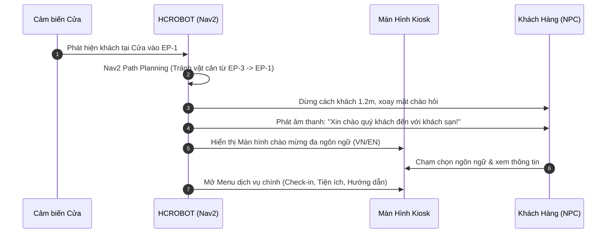
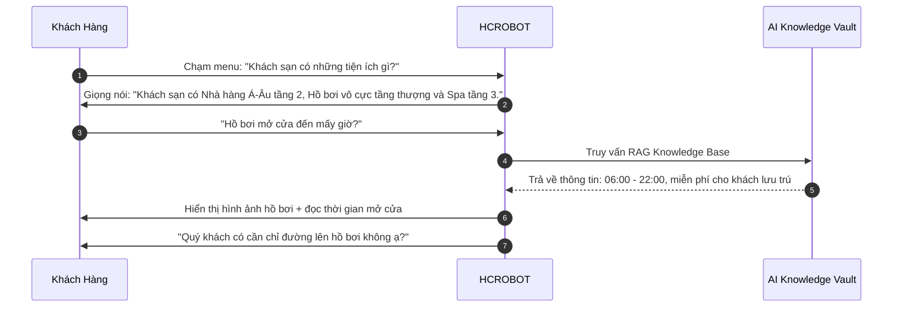
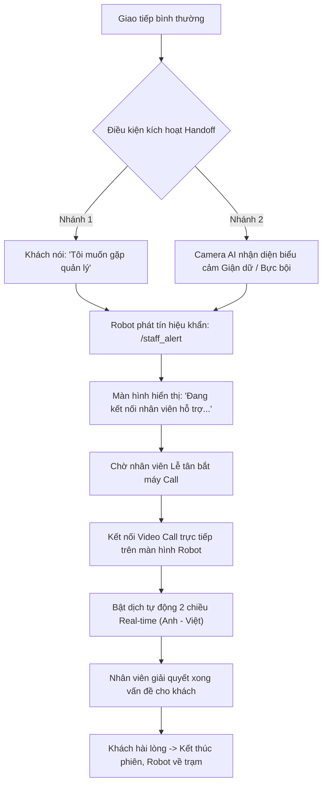
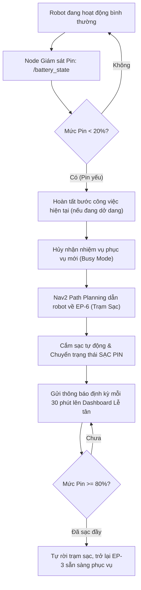

# 🤖 Kịch Bản Giả Lập Gazebo — Hotel Concierge Robot (HCROBOT)

> **Dự án**: Robot Dịch Vụ Tiếp Tân Khách Sạn (HCROBOT)  
> **Học phần**: Đồ Án Tốt Nghiệp — FPT University  
> **Môi trường mô phỏng**: Gazebo Sim + ROS 2 + Nav2 Navigation Stack  
> **Bản đồ sa bàn**: Sảnh Khách Sạn (Hotel Lobby) — Kích thước thực tế: **19.60m × 12.60m**

---

## 1. Tổng Quan Không Gian Sa Bàn & Thiết Lập Quy Hoạch (Zone & Endpoints)

### 1.1. Bản đồ & Khu vực chức năng (Zones)
Môi trường sảnh khách sạn trong Gazebo được phân chia thành các vùng chức năng áp dụng các bộ lọc Nav2 Costmap Filter:

| Ký hiệu | Tên vùng | Loại vùng Nav2 | Tọa độ & Phạm vi | Ý nghĩa vận hành |
|---|---|---|---|---|
| **NG-1** | Phòng Nội Bộ Quầy Lễ Tân | `KEEP_OUT` (Cấm vào) | $X \approx 11.44m, Y \approx 6.40m$ | Khu vực nhân viên làm việc phía sau quầy, robot tuyệt đối không đi vào. |
| **NG-2** | Khu Vực WC Nam & Nữ | `KEEP_OUT` (Cấm vào) | Góc phải dưới bản đồ ($X: 15.5m - 19.6m$) | Khu vệ sinh, robot không nhận điểm đến và không đi qua. |
| **SZ-1** | Hành Lang Tiếp Tân | `SPEED_ZONE` (Giảm tốc) | $X \approx 11.44m, Y \approx 2.80m$ | Tốc độ tối đa giới hạn **$0.20\text{ m/s}$**, mật độ khách tập trung đông. |
| **SZ-2** | Khu Vực Sofa Chờ | `SPEED_ZONE` (Giảm tốc) | Khu sofa khách ngồi chờ | Tốc độ tối đa **$0.25\text{ m/s}$** để đảm bảo an toàn cho khách ngồi thư giãn. |
| **NS-1** | Lối Cửa Thông Sảnh | `NO_STOP` (Cấm dừng) | $X \approx 12.84m, Y \approx 9.80m$ | Lối đi huyết mạch nối 2 gian sảnh, robot chỉ được đi ngang qua, cấm dừng/chờ chắn lối. |

### 1.2. Danh sách các Điểm Mốc (Endpoints / Waypoints)

| ID | Tên Điểm Mốc | Loại | Tọa độ $(X, Y, \theta)$ | Mục đích sử dụng |
|---|---|---|---|---|
| **EP-1** | **Cửa Vào Chính (Main Entrance)** | `WAYPOINT` | $(2.2m, 6.3m, 0^\circ)$ | Điểm đón khách mới bước vào khách sạn (Workflow 1). |
| **EP-2** | **Quầy Lễ Tân (Front Desk)** | `WAYPOINT` | $(10.0m, 4.0m, 90^\circ)$ | Điểm tham chiếu trước quầy lễ tân trên sa bàn. |
| **EP-3** | **Trạm Chờ Sofa (Sofa Waiting)** | `PARK` | $(4.0m, 9.6m, -45^\circ)$ | Vị trí đỗ trực mặc định (Home Base) khi robot rảnh rỗi. |
| **EP-4** | **Cụm Thang Máy (Elevator Cluster)**| `WAYPOINT` | $(17.5m, 6.5m, 0^\circ)$ | Điểm dẫn khách lên phòng lưu trú (Workflow 7). |
| **EP-5** | **Trung Tâm Sảnh (Lobby Center)** | `WAYPOINT` | $(7.5m, 6.3m, 0^\circ)$ | Điểm tuần tra, chiếu poster sự kiện và chào hỏi khách (Workflow 6). |
| **EP-6** | **Trạm Sạc Tự Động (Docking Station)**| `CHARGER` | $(1.5m, 1.5m, 180^\circ)$| Điểm sạc pin khi dung lượng pin $< 20\%$. |

---

### 1.3. Khách giả lập trên sa bàn web

Simulator trên web hiển thị một biểu tượng **Guest 01 · Simulated** cùng vị trí, trạng thái và bong bóng hội thoại. Đây là khách minh họa tương tác; không yêu cầu có mô hình người trong Gazebo.

* **Đón khách (WF01)**: Khách xuất hiện ở cửa chính và chờ robot đến chào.
* **Tư vấn, yêu cầu dịch vụ, đánh giá (WF02/WF03/WF05)**: Khách tiếp cận robot; trạng thái thay đổi theo bước đang chạy. Phiếu dịch vụ trên simulator vẫn dùng chế độ preview.
* **Dẫn đường (WF07)**: Khách đi theo dấu đường robot vừa đi, giữ khoảng cách; khi robot quay về trạm, khách rời khỏi phiên tương tác tại điểm đến.
* **Quảng cáo (WF06)**: Bấm **Guest arrives** để thêm khách và tạm dừng bước quảng cáo. **Guest leaves** cho khách rời đi và tiếp tục phần thời gian quảng cáo còn lại.
* **Điều khiển demo**: Thanh **Guest interaction** có các nút **Guest arrives**, **Simulate reply**, **Guest leaves**. Nút trả lời minh họa phản hồi bằng bong bóng; việc chọn dịch vụ và xác nhận yêu cầu thực hiện trên form preview hiện có.
* **Pause / Stop / Reset**: Pause dừng chuyển động khách; Stop/Reset xóa khách; đổi workflow hoặc bắt đầu lượt mới tạo lại trạng thái. Nhãn mới theo ngôn ngữ Settings, mặc định tiếng Anh.

Biểu tượng khách chỉ nằm trên web, không phát hiện người bằng camera và không tạo vật cản cho LiDAR/Nav2. Để kiểm tra tránh người trong Gazebo, cần bổ sung vật cản hoặc mô hình có va chạm trong môi trường mô phỏng.

---

## 2. Chi Tiết 6 Kịch Bản Giả Lập Chuẩn

Phạm vi demo gồm các kịch bản **1, 2, 3, 5, 6 và 7**. Giữ nguyên số kịch bản và mã workflow để đối chiếu với hệ thống.

---

### 🎬 Kịch Bản 1: Đón Tiếp & Chào Mừng Khách Tại Cửa Sảnh
* **Mã Workflow**: `Workflow 1`
* **Cơ chế kích hoạt**: Cảm biến LiDAR / Camera phát hiện khách bước qua cửa vào (`/person_detected = true`).
* **Chuỗi bước thực thi**: `MOVE` $\rightarrow$ `GREET` $\rightarrow$ `SHOW` $\rightarrow$ `COMMUNICATE` $\rightarrow$ `SHOW`



* **Thời gian giả lập**: 40 giây.
* **Tiêu chí hoàn thành**: Robot tiếp cận đúng vị trí cách khách $1.0 - 1.2m$, không va quẹt cửa kính, menu hiển thị đúng sau khi dừng.

---

### 🎬 Kịch Bản 2: Gợi Ý & Tư Vấn Tiện Ích Khách Sạn Tại Sảnh
* **Mã Workflow**: `Workflow 2`
* **Cơ chế kích hoạt**: Khách chạm màn hình Kiosk tại khu vực sảnh hoặc trạm chờ.
* **Chuỗi bước thực thi**: `SHOW` $\rightarrow$ `COMMUNICATE` $\rightarrow$ `RECOMMEND` $\rightarrow$ `SHOW` $\rightarrow$ `COMMUNICATE`



* **Thời gian giả lập**: 30 giây.
* **Tiêu chí hoàn thành**: AI phản hồi chính xác thông tin từ kho tri thức, hiển thị poster hình ảnh rõ ràng.

---

### 🎬 Kịch Bản 3: Đặt Dịch Vụ Buồng Phòng & Gọi Taxi Đón Tại Sảnh
* **Mã Workflow**: `Workflow 3`
* **Cơ chế kích hoạt**: Khách chọn dịch vụ "Gọi xe Taxi" hoặc "Yêu cầu dọn phòng/thêm khăn".
* **Chuỗi bước thực thi**: `SHOW` $\rightarrow$ `COMMUNICATE` $\rightarrow$ `CREATE_REQUEST` $\rightarrow$ `COMMUNICATE` $\rightarrow$ `SHOW`

1. **Bước 1 (SHOW)**: Màn hình hiển thị danh mục dịch vụ buồng phòng & gọi xe taxi liên kết.
2. **Bước 2 (COMMUNICATE)**: Robot hỏi: *"Vui lòng nhập số phòng và mã PIN bảo mật để xác nhận yêu cầu."*
3. **Bước 3 (CREATE_REQUEST)**:
   * Khách nhập số phòng: `302`, PIN: `****`.
   * Hệ thống kiểm tra hợp lệ $\rightarrow$ Tạo ticket lên Dashboard Lễ tân/Buồng phòng (`/service_request`).
   * Đồng thời kích hoạt thông báo chuông alert tới nhân viên trực ban.
4. **Bước 4 (COMMUNICATE)**: Robot phát giọng nói: *"Yêu cầu của quý khách đã được chuyển tới bộ phận liên quan. Taxi sẽ đón quý khách tại sảnh sau 5 phút."*
5. **Bước 5 (SHOW)**: Hiển thị mã vé đặt và trạng thái đang xử lý.

* **Thời gian giả lập**: 35 giây.

---

### 🎬 Kịch Bản 5: Đánh Giá Dịch Vụ & Robot Tự Quay Về Trạm Chờ Sảnh
* **Mã Workflow**: `Workflow 5`
* **Cơ chế kích hoạt**: Sau khi kết thúc một phiên tương tác hoặc khi phiên giao dịch hoàn tất.
* **Chuỗi bước thực thi**: `SHOW` $\rightarrow$ `FEEDBACK` $\rightarrow$ `COMMUNICATE` $\rightarrow$ `MOVE`

1. **Bước 1 (SHOW)**: Màn hình robot hiện giao diện đánh giá hài lòng (1 đến 5 sao) kèm các tiêu chí nhanh (Thân thiện, Nhanh chóng, Rõ ràng).
2. **Bước 2 (FEEDBACK)**: Khách chọn 5 sao ⭐⭐⭐⭐⭐.
3. **Bước 3 (COMMUNICATE)**: Robot mỉm cười biểu cảm trên màn hình LED Face và phát âm thanh: *"Cảm ơn quý khách rất nhiều! Chúc quý khách một ngày tuyệt vời!"*
4. **Bước 4 (MOVE)**: Robot tự động kiểm tra bản đồ, điều hướng an toàn quay trở về vị trí trực mặc định `EP-3` (Sofa Trạm Chờ).

---

### 🎬 Kịch Bản 6: Tuần Tra Sảnh & Chiếu Quảng Cáo Sự Kiện (Scheduled Routine)
* **Mã Workflow**: `Workflow 6` (Chế độ kích hoạt theo lịch định kỳ)
* **Cơ chế kích hoạt**: Định kỳ mỗi 15 hoặc 30 phút khi robot ở trạng thái IDLE.
* **Chuỗi bước thực thi**: `MOVE` $\rightarrow$ `SHOW`

1. **Bước 1 (MOVE)**: Robot rời `EP-3`, di chuyển tuần tra dọc tuyến hành lang chính: `EP-3` $\rightarrow$ `EP-5` (Trung tâm sảnh).
2. **Tuân thủ vùng**: Trên đường tuần tra, robot chủ động né tránh người đi bộ và chướng ngại vật động (dynamic obstacle avoidance).
3. **Bước 2 (SHOW)**: Khi đến tâm sảnh `EP-5`, robot dừng lại trong 60 giây:
   * Chạy video/banner giới thiệu Buffet tối và chương trình khuyến mãi Spa.
   * Xoay nhẹ góc quan sát để sẵn sàng chào đón nếu có khách tiếp cận.
4. **Kết thúc**: Hết thời gian trình chiếu, robot tự hành về lại `EP-3`.

---

### 🎬 Kịch Bản 7: Chỉ Đường & Dẫn Khách Tới Cụm Thang Máy (Elevator)
* **Mã Workflow**: `Workflow 7`
* **Cơ chế kích hoạt**: Khách yêu cầu: *"Chỉ tôi đường lên phòng / Chỉ đường đến thang máy."*
* **Chuỗi bước thực thi**: `SHOW` $\rightarrow$ `COMMUNICATE` $\rightarrow$ `MOVE` $\rightarrow$ `COMMUNICATE` $\rightarrow$ `MOVE`

1. **Bước 1 (SHOW)**: Hiển thị sơ đồ mini dẫn đường tới cụm thang máy (Kiosk Wayfinding).
2. **Bước 2 (COMMUNICATE)**: Robot hỏi: *"Quý khách ở tầng mấy ạ? Xin mời quý khách đi theo tôi đến khu vực thang máy."*
3. **Bước 3 (MOVE)**: Robot điều hướng từ vị trí hiện tại dẫn khách đến `EP-4` (Cụm Thang Máy). Đi qua lối thông sảnh `NS-1` theo quy tắc đi xuyên, không dừng lại giữa lối.
4. **Bước 4 (COMMUNICATE)**: Đến nơi, robot dừng cách cửa thang máy $1.5m$, xoay mặt về phía thang máy và thông báo: *"Thang máy ở ngay phía trước. Chúc quý khách nghỉ ngơi thoải mái!"*
5. **Bước 5 (MOVE)**: Robot tự quay trở về trạm chờ `EP-3`.

---

## 3. Hai Kịch Bản Mở Rộng Đặc Biệt (Core Unique Workflows)

### 🚨 Kịch Bản Đặc Biệt 1: Robot-to-Human Handoff Flow (Chuyển Giao Người)

Khi khách hàng gặp vấn đề vượt quá khả năng xử lý tự động của AI, hoặc khi khách có biểu cảm bất mãn:



* **Điểm nhấn thuyết trình**: Thể hiện tính nhân văn và độ tin cậy thực tế của robot trong ngành hiếu khách (Hospitality) — không bỏ rơi khách hàng khi AI gặp giới hạn.

---

### 🔋 Kịch Bản Đặc Biệt 2: Low Battery & Auto-Docking Flow (Tự Hành Về Trạm Sạc)



---

## 4. Bảng Tổng Hợp ROS 2 Topics & Giao Thức Liên Lạc

| Topic Name | Message Type | Chức năng trong Gazebo |
|---|---|---|
| `/cmd_vel` | `geometry_msgs/msg/Twist` | Lệnh vận tốc điều khiển động cơ robot di chuyển |
| `/amcl_pose` | `geometry_msgs/msg/PoseWithCovarianceStamped` | Tọa độ định vị vị trí robot trên bản đồ sảnh |
| `/scan` | `sensor_msgs/msg/LaserScan` | Dữ liệu cảm biến quét LiDAR 2D tránh vật cản |
| `/person_detected` | `std_msgs/msg/Bool` | Cảnh báo có khách tiếp cận tại các vị trí cửa sảnh |
| `/face_expression` | `std_msgs/msg/String` | Trạng thái cảm xúc khuôn mặt (`NEUTRAL`, `HAPPY`, `ANGRY`) |
| `/service_request` | `std_msgs/msg/String` | Dữ liệu ticket yêu cầu dịch vụ gửi về server |
| `/staff_alert` | `std_msgs/msg/String` | Tín hiệu chuông báo động gọi nhân viên hỗ trợ khẩn cấp |
| `/battery_state` | `sensor_msgs/msg/BatteryState` | Điện áp, dòng điện và phần trăm dung lượng pin |
| `/hotel_zones` | `std_msgs/msg/String` | Đồng bộ các vùng quy định `KEEP_OUT`, `SPEED_ZONE`, `NO_STOP` |

---

## 5. Quy Trình Demo Mẫu Khuyến Nghị (Thứ Tự Trình Bày Thuyết Trình)

Để buổi bảo vệ đồ án mạch lạc và ấn tượng nhất với Hội đồng, nhóm nên trình diễn theo thứ tự 5 giai đoạn sau:

```
[Giai đoạn 1: Giới thiệu sa bàn]
   └── Chạy Kịch bản 6 (Tuần tra sảnh): Cho robot tự hành từ trạm chờ ra giữa sảnh chiếu quảng cáo.
       Hội đồng sẽ thấy toàn cảnh bản đồ Gazebo, khả năng né vật cản và tuân thủ vùng giảm tốc.

[Giai đoạn 2: Trải nghiệm khách hàng cốt lõi (Guest Journey)]
   └── Chạy Kịch bản 1 (Đón khách tại cửa)
       └── Tiếp nối Kịch bản 2 (Tư vấn tiện ích sảnh)
           └── Kết thúc bằng Kịch bản 3 (Khách đặt xe Taxi / dịch vụ buồng phòng).

[Giai đoạn 3: Tính năng Dẫn đường (Escort Wayfinding)]
   └── Chạy Kịch bản 7: Robot dẫn khách tới Thang Máy,
       đi qua lối thông sảnh cấm dừng (No-Stop Zone) chuẩn xác.

[Giai đoạn 4: Điểm nhấn công nghệ (Showcase Edge Cases)]
   └── Trình diễn Robot-to-Human Handoff: Giả lập khách bực bội -> Gọi video call nhân viên lễ tân.

[Giai đoạn 5: Tự chủ năng lượng & Kết thúc phiên]
   └── Kịch bản Pin yếu: Giả lập pin giảm dưới 20% -> Robot chào tạm biệt và tự lùi vào trạm sạc EP-6.
```

